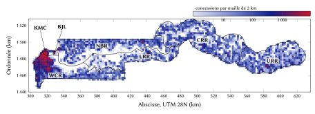
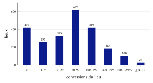
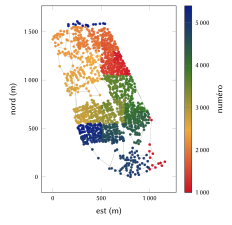
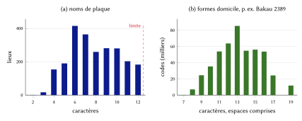
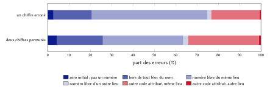
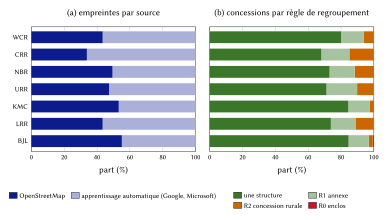

# Introduction

Une adresse remplit deux fonctions. Elle permet à une personne ou à un véhicule de trouver une porte, et elle permet à une institution de désigner cette porte dans ses registres. Dans la plus grande partie de la Gambie, aucune de ces deux fonctions n'est assurée par une adresse de rue classique. Hors de quelques rues de l'époque coloniale à Banjul et des rues que Kanifing est en train de nommer, peu de rues portent un nom sur le terrain et peu de portes un numéro. Les livraisons se font par téléphone, de repère en repère ; une équipe d'ambulance dépend de la description de l'appelant ; et un conseil municipal identifie la concession d'un contribuable par le nom de son propriétaire [@jobe2026].

La réponse du gouvernement est la Politique nationale d'adressage numérique de 2023, qui adopte les Plus Codes (l'Open Location Code) comme adresse numérique nationale [@mocde2023; @olc]. Un Plus Code se calcule à partir d'une position, ne demande aucun registre et existe pour chaque point du pays. Le Conseil municipal de Kanifing a relié ces codes à sa base de données de la taxe foncière [@jobe2026; @badji2025], et le ministère des Communications et de l'Économie numérique indique avoir numérisé 34 464 adresses à Banjul et à Kanifing [@dem2023]. Ce que le Plus Code fait mal, en revanche, c'est ce à quoi une adresse sert le plus souvent dans la vie quotidienne : se dire à voix haute, se retenir après une seule écoute, s'écrire sur un colis sans faute.

Ce rapport décrit un modèle qui conserve le Plus Code comme adresse officielle et lui adjoint, pour chaque concession, un *code d'adresse* : un nom de lieu que l'on dit déjà et un numéro court, comme **Bakau 2389**. La difficulté est double. Il faut rendre ce code unique dans tout le pays sans qualificatif, alors que de nombreux noms de lieux gambiens se répètent (*Madina* désigne quinze lieux, *Brikama* cinq). Et il faut que les numéros suivent le terrain, pour qu'un code indique aussi à un livreur, à peu près, où se trouve la concession le long d'une ruelle.

Nos contributions sont les suivantes.

1. Un modèle d'adressage complet dont chaque règle est donnée sous forme de formule : les zones, le regroupement des bâtiments en concessions, l'inventaire des lieux et leurs noms de plaque courts, une clé de nom phonétique, une plage nationale de numéros par nom avec des blocs disjoints, une numérotation le long d'une courbe de Hilbert avec insertion des nouvelles concessions, un chiffre de contrôle de Damm et le calcul du Plus Code officiel (section 4).
2. Une mise en œuvre qu'un tiers peut exploiter sans nous : un moteur de référence en bibliothèque standard avec ses vecteurs de conformité, le registre complet des 471 031 codes avec toutes les empreintes de bâtiments, et un serveur de registre dont les réponses et les décisions d'attribution sont identiques à celles de l'émetteur (section 5).
3. Une évaluation sur l'ensemble du registre : unicité, décodage, longueur des codes, localité de l'ordre, conséquences des erreurs de saisie, exactitude des Plus Codes, et comparaison avec le recensement de 2024 (section 6), ainsi que les conceptions écartées et leurs raisons (section 7).
4. Des estimations des bénéfices pour les citoyens, la logistique, les services d'urgence et l'administration, chacune avec ses hypothèses et une plage de sensibilité (sections 8 à 11), suivies de la vie privée et de la gouvernance (section 12) et des limites (section 13).

# Contexte et travaux connexes

## L'adressage en Gambie

**L'adresse numérique nationale.** La Politique nationale d'adressage numérique [@mocde2023], préparée pour le ministère des Communications et de l'Économie numérique par l'e-Governance Academy d'Estonie, indique que le gouvernement a « adopté et mis en œuvre un système d'adressage numérique fondé sur la solution Google Plus Codes ». Elle confie à la Gambia Postal Services Corporation (GAMPOST) l'intégration du système national dans ses procédures et sa distribution à domicile. L'Initiative d'adressage numérique présente le programme [@dai2026]. Les adresses s'écrivent sous la forme d'un code court suivi de la ville, par exemple `F8HC+9G6 Bakau`.

**La pratique des conseils.** Entre juillet 2021 et février 2022, le Conseil municipal de Kanifing a mis en place un adressage par Plus Codes pour environ 500 000 habitants ; il a géoréférencé 36 000 propriétés et s'en sert pour la gestion des déchets et le recouvrement de la taxe foncière [@badji2025]. Ses responsables expliquent qu'auparavant les agents de recouvrement identifiaient les concessions par le nom des propriétaires, que les codes sont désormais reliés à la base de la taxe foncière, que le conseil a refusé de les remplacer par des étiquettes plus simples qui perdraient en précision, et qu'une numérotation séquentielle des rues est introduite en complément [@jobe2026]. En janvier 2023, le ministère a fait état de 34 464 adresses numérisées à Banjul et à Kanifing lors d'un projet pilote mené en 2022, et de 48 770 adresses recensées dans le Kombo North, soit près du double des propriétés enregistrées dans la base du Conseil de Brikama [@dem2023].

**Codes postaux et numéros de porte.** La Gambie n'utilise pas de codes postaux et GAMPOST n'en publie aucune liste ; on écrit l'adresse avec la ville. Les numéros de porte sont rares. Dans OpenStreetMap, 19 concessions portent une rue et un numéro [@osm] ; le modèle les affiche en premier, tels qu'ils sont écrits.

**Le recensement.** Le recensement général de la population et de l'habitat de 2024 a dénombré 2 422 712 habitants, 297 581 ménages, 201 827 concessions et 547 528 bâtiments ou structures, avec un taux de croissance intercensitaire de 2,5 % par an depuis 2013 [@gbos2024]. La seule zone d'administration locale de Brikama rassemble 47,5 % de la population. Les zones de dénombrement ne sont pas des données ouvertes ; nous n'utilisons le recensement que comme contrôle externe de nos propres décomptes (section 6.7).

## Pratiques internationales

La norme S42 de l'Union postale universelle définit les composantes d'une adresse postale et des modèles nationaux pour la présenter [@upus42]. Elle décrit comment écrire une adresse, non comment choisir un code là où les rues n'ont pas de nom. L'étude de la Banque mondiale consacrée aux programmes d'adressage de 52 villes africaines entre 1989 et 2004 relève que, sur un échantillon de 21 villes, 8 % seulement des rues avaient un nom avant l'adressage, et que nommer les rues, numéroter les portes et poser les plaques coûtait en moyenne 5,7 dollars américains par porte adressée [@farvacque2005]. Sa leçon principale pour notre travail est qu'une adresse que les gens n'utilisent pas se dégrade : les plaques disparaissent et l'on revient aux repères.

Les systèmes nationaux d'adresse numérique de la région suivent l'approche par grille. GhanaPostGPS, lancé en 2017, découpe le pays en carrés de 5 m et attribue à chacun un code associant un préfixe régional et une référence de grille [@citifm2017]. Le choix gambien des Plus Codes appartient à la même famille : le code se calcule à partir d'une position et ne demande aucun registre.

## Pourquoi aucun système de codes ne suffit seul

Le tableau 1 compare quatre types d'adresse au regard des usages qu'une adresse doit servir. Un code de grille comme le Plus Code est calculable, utilisable hors connexion et ouvert, mais ses symboles se disent et se retiennent mal. Les systèmes à mots aléatoires [@w3w] désignent des carrés de quelques mètres par trois mots du dictionnaire, plus faciles à dire ; mais ils nomment des carrés et non des concessions, ne disent rien du lieu et reposent sur une liste de mots propriétaire. La numérotation des rues et des portes correspond à ce que l'on attend d'une adresse, mais elle suppose des rues nommées, dont la plus grande partie du pays est dépourvue [@farvacque2005]. Un nom de lieu et un numéro, c'est ce que les Gambiens disent déjà (« à Bakau, près de… ») ; il s'agit de le rendre exact.

| Type | Exemple | À l'oral | Mémorisation | Unique seul | Registre requis |
|:---------------|:-------------|:-------------|:-----------|:-------------|:-----------------|
| Code de grille (Plus Code) | `F8HC+9G6 Bakau` | difficile : 8 symboles | difficile | oui, avec la ville | non |
| Rue et numéro | `12 Atlantic Road` | facile | facile | avec la ville | oui, et des rues nommées |
| Mots pour des carrés | trois mots | facile | moyenne | oui | oui, une liste de mots |
| Nom de lieu et numéro | `Bakau 2389` | facile | facile | oui | oui, le registre |

: Types d'adresse comparés aux usages qu'une adresse doit servir.

La mémoire à court terme retient environ quatre unités [@cowan2001]. Prononcé, un code d'adresse se compose d'un nom et d'un ou deux groupes de chiffres (« Bakau, vingt-trois, quatre-vingt-neuf »), soit dans cette limite ; un Plus Code compte huit symboles indépendants ou plus.

# Données et sources

**Zones.** Les sept zones du code sont les cinq régions, la ville de Banjul et la municipalité de Kanifing. Leurs contours sont les relations de limites administratives de niveau 4 d'OpenStreetMap [@osm], reprises entières et figées lors de la première attribution (figure 1).

**Lieux.** L'inventaire des lieux combine les lieux d'OpenStreetMap et les localités de GeoNames [@geonames]. La section 4.4 décrit les règles qui en tirent 2 347 lieux.

**Bâtiments.** Le registre contient 672 836 empreintes de bâtiments : 296 550 issues d'OpenStreetMap et 376 286 empreintes produites par apprentissage automatique, de Google Open Buildings [@sirko2021] et des Global ML Building Footprints de Microsoft [@msbuildings], fusionnées par le thème « bâtiments » d'Overture Maps, qui conserve d'abord les bâtiments cartographiés par la communauté et complète avec les contours appris [@overture]. La part de chaque source varie selon la zone (figure 8a) : OpenStreetMap fournit 55 % des empreintes à Banjul et 34 % dans la région Central River.

**Équipements.** Les distances d'accès de la section 11 utilisent les établissements de santé, écoles, postes de police et pharmacies de la carte N-Ways, qui associe les points d'intérêt d'OpenStreetMap à des fiches d'établissements ; cette couche ne fait pas partie du registre.

{#fig:zones width=100%}

| Indice | Clé | Zone | ISO 3166-2 | Concessions | Cadre $F$ (km) |
|--:|:--|:--|:--|--:|--:|
| 0 | BJL | Banjul | GM-B | 4 320 | 7 |
| 1 | CRR | Central River | GM-M | 54 222 | 110 |
| 2 | KMC | Kanifing | aucun | 45 338 | 16 |
| 3 | LRR | Lower River | GM-L | 19 377 | 119 |
| 4 | NBR | North Bank | GM-N | 53 630 | 137 |
| 5 | URR | Upper River | GM-U | 48 103 | 83 |
| 6 | WCR | West Coast | GM-W | 246 041 | 111 |

: Les sept zones, leurs codes attribués et le côté de leur cadre de Hilbert. La municipalité de Kanifing n'a pas de code ISO 3166-2 propre.

# Le modèle

## Les formes d'un code d'adresse

Un code d'adresse a quatre formes en correspondance biunivoque (tableau 3). Soit $P$ le nom de plaque du lieu, $N$ son numéro, $Z$ le nom de la zone, $K$ sa clé, $I$ l'indice du lieu dans sa zone et $c$ le chiffre de contrôle. Alors

$$
\text{domicile} = P \;\, g(N), \qquad
\text{écrite} = \mathrm{maj}(P) \;\, g(N) \cdot \mathrm{maj}(Z), \qquad
\text{machine} = \texttt{GM-}K\texttt{-}I\texttt{-}N\texttt{-}c,
\tag{1}
$$

où $I$ s'écrit sur quatre chiffres et où le groupement $g$ coupe les numéros de cinq chiffres pour la lecture :

$$
g(N) =
\begin{cases}
N, & N < 10^4,\\
\lfloor N / 1000 \rfloor \;\, (N \bmod 1000), & N \ge 10^4 .
\end{cases}
\tag{2}
$$

| Forme | Exemple | Usage |
|:--|:--|:--|
| Adresse officielle (celle du gouvernement) | `F8HC+9G6 Bakau` | affichée en premier, partout |
| Domicile | `Bakau 2389` | les personnes : dite, saisie, écrite sur un colis |
| Écrite | `BAKAU 2389 · KANIFING` | plaques, autocollants et formulaires |
| Machine | `GM-KMC-0001-2389-6` | applications, codes QR et partenaires |

: Les formes d'un même code. Seule la forme machine porte le chiffre de contrôle.

L'ordre d'affichage est fixe : l'adresse de rue d'un conseil quand elle existe, sinon le Plus Code gouvernemental de l'entrée de la concession avec sa ville, et à côté le code d'adresse. Le modèle n'émet aucune grille propre et ne présente jamais le code d'adresse comme adresse officielle.

## Zones et cadres

Un point $p = (\varphi, \lambda)$ appartient à la zone dont le contour le contient, testé par lancer de rayon. En cas de chevauchement, l'indice le plus bas l'emporte ; un point hors de tout contour (une berge, le rivage) prend la zone dont un sommet du contour est le plus proche, à moins de 2 km :

$$
\mathrm{zone}(p) =
\begin{cases}
\min\{\, i(z) : p \in \Omega_z \,\}, & \text{si un contour } \Omega_z \ni p,\\
\arg\min_z \min_{v \in \partial\Omega_z} \lVert u(p) - u(v) \rVert, & \text{si cette distance} \le 2000\ \text{m},\\
\text{aucune}, & \text{sinon},
\end{cases}
\tag{3}
$$

où $u$ est la projection en WGS 84 / UTM zone 28N (section 4.12) et où $v$ parcourt les sommets du contour.

Chaque zone porte un cadre carré qui ne sert qu'à ordonner les concessions (section 4.8). Avec $E$ et $N$ les coordonnées projetées du contour de la zone, le coin sud-ouest et le côté du cadre sont

$$
E_0 = 1000 \left\lfloor \frac{\min E}{1000} \right\rfloor, \quad
N_0 = 1000 \left\lfloor \frac{\min N}{1000} \right\rfloor, \quad
F = 1000 \left\lceil \frac{\max(\max E - E_0,\ \max N - N_0)}{1000} \right\rceil .
\tag{4}
$$

Le cadre de Kanifing commence à $E_0 = 313\,000$ m, $N_0 = 1\,483\,000$ m et a pour côté $F = 16$ km.

## Les concessions

L'unité d'adresse est la concession : la parcelle que dessert un portail. Les empreintes sont regroupées par quatre règles appliquées dans l'ordre, au moyen d'une structure union-find, de sorte que le résultat ne dépend pas de l'ordre des données. Une structure est *urbaine* lorsque sa tuile de 250 m compte au moins 100 structures (1 600 par km²). L'écart entre deux structures $a$ et $b$ de centres $\mathbf{c}_a, \mathbf{c}_b$ et d'aires $A_a, A_b$ est la distance entre les centres diminuée des rayons des cercles de même aire :

$$
\gamma(a, b) = \lVert \mathbf{c}_a - \mathbf{c}_b \rVert - \sqrt{A_a / \pi} - \sqrt{A_b / \pi} .
\tag{5}
$$

| Règle | Condition | Effet | Concessions |
|:------------|:--------------------------|:-------------------|---------:|
| R0 enclos | centre dans un site clos ou une concession cartographiés | toutes ses structures forment une concession | 600 |
| R1 annexe | $A < 30$ m² et $\gamma \le 4$ m (urbain) ou $\le 8$ m (rural) d'une structure d'au moins 30 m² | rejoint cette concession | 70 040 |
| R2 concession rurale | rural ; les deux $A < 120$ m² ; $\gamma \le 6$ m | groupes à lien simple, 30 au plus | 37 245 |
| aucune | | la structure forme sa propre concession | 363 145 |

: Règles de regroupement et nombre de concessions de première attribution formées par chacune.

Deux structures principales en tissu urbain ne sont jamais réunies sur la seule base de leur forme : à Serrekunda et à Brikama, des maisons mitoyennes restent des concessions distinctes, sauf si un mur est cartographié ou si les habitants en décident autrement. Sur les 471 031 codes, 107 632 comptent plus d'une structure (70 813 deux, 19 254 trois, 17 565 quatre ou plus). Le centre d'une concession est le barycentre de ses structures pondéré par leur aire ; son entrée est un portail cartographié sur son enclos lorsqu'il existe (17 aujourd'hui), sinon son centre.

Chaque structure porte aussi une classe d'usage avec un niveau de confiance et sa justification, selon une échelle : les attributs d'OpenStreetMap, puis les lieux N-Ways situés dans l'empreinte, puis la forme [@osm]. Les hauteurs fournies avec les empreintes apprises sont des valeurs de rendu, non des mesures, et ne sont pas utilisées. La structure principale est une maison dans 370 331 concessions, une concession familiale dans 44 230 et une case dans 33 223 ; 21 770 restent non classées. Les identifiants de classe tels que `res.maison` sont des codes stables des données publiées.

## Les lieux

Le nom de lieu est celui d'une ville, d'un village, d'un faubourg ou d'un quartier que l'on dit. L'inventaire se construit en cinq étapes.

1. *Exclusion des repères.* Un nom contenant *point, island, roundabout, junction, traffic light, bridge, wharf, ferry, crossing, market* ou *airport* ne désigne aucun domicile ; 41 noms ont été écartés. Sans cette règle, *Dockyard Point* nommerait une bonne partie de Banjul, et *Sukuta Traffic Light* 4 780 domiciles de Sukuta.
2. *Doublons.* Un lieu cartographié deux fois (un point et une surface à moins de 1 km ayant la même clé de nom) garde son premier identifiant (140 cas). Une localité GeoNames est écartée lorsqu'un lieu OpenStreetMap se trouve à moins de 300 m, ou à moins de 1 km avec la même clé de nom (279 cas).
3. *Parenthèses.* Un second nom entre parenthèses devient un alias : *Busura (Kunkujang)* devient *Busura*, et la saisie de *Kunkujang* le retrouve.
4. *Indice.* Dans chaque zone, les lieux sont triés par clé de nom puis par identifiant, et numérotés à partir de 0. L'indice est figé.
5. *Du point au lieu.* Une concession $c$ prend le lieu le plus proche, de tout type, à moins de 2,5 km ; à défaut la ville la plus proche à moins de 10 km ; à défaut le lieu le plus proche de sa zone, les égalités allant à l'indice le plus bas :

$$
\mathrm{lieu}(c) =
\begin{cases}
\arg\min_{q \in \mathcal{P}(z)} d(c, q), & \text{si } \min_{q \in \mathcal{P}(z)} d(c,q) \le 2500\ \text{m},\\
\arg\min_{q \in \mathcal{T}(z)} d(c, q), & \text{si } \min_{q \in \mathcal{T}(z)} d(c,q) \le 10\,000\ \text{m},\\
\arg\min_{q \in \mathcal{P}(z)} d(c, q), & \text{sinon},
\end{cases}
\tag{6}
$$

où $\mathcal{P}(z)$ est l'ensemble des lieux de la zone $z$, $\mathcal{T}(z) \subseteq \mathcal{P}(z)$ ses villes, et $d$ la distance en mètres UTM.

On obtient 2 347 lieux : 1 187 localités, 1 072 villages, 38 faubourgs, 27 bourgs, 18 quartiers et 5 villes. Le lieu médian compte 42 concessions ; 419 lieux n'en comptent aucune aujourd'hui, pour la plupart des hameaux dont les bâtiments ne sont pas encore cartographiés, et gardent leur bloc pour le jour où ils le seront (figure 2).

{#fig:places width=72%}

## Les noms de plaque

Le nom inscrit dans le code doit être assez court pour se dire et se peindre : 12 caractères au plus (lettres, espaces et traits d'union comptent chacun pour un ; une lettre accentuée compte pour un) et deux mots, sans compter les mots de liaison (*and, of, the*). Un nombre final compte dans les caractères seulement, comme dans *Brusubi 1* :

$$
\mathrm{ok}(s) \iff \lvert \mathrm{NFC}(s) \rvert \le 12 \;\wedge\; \lvert \mathrm{mots}(s) \setminus L \rvert \le 2 ,
\tag{7}
$$

où $L$ est l'ensemble des mots de liaison. Un nom qui échoue est raccourci en trois temps : un nombre final est mis de côté ; les mots génériques (*village, ward, town, settlement, area, layout, quarters, island, point, wharf, phase, roundabout*) sont retirés ; et si le nom ne tient toujours pas, chaque suite d'un ou deux mots entiers qui tient devient candidate, et l'on retient celle dont les mots sont les plus rares parmi tous les noms de lieux gambiens :

$$
r(x) = \frac{1}{\lvert \mathrm{mots}(x) \rvert} \sum_{w \in \mathrm{mots}(x)} f(w), \qquad
\mathrm{plaque}(s) = \arg\min_x \big( r(x),\, -\lvert \mathrm{mots}(x) \rvert,\, -\lvert x \rvert \big),
\tag{8}
$$

où $f(w)$ est le nombre de noms de lieux gambiens contenant $w$, le minimum étant pris dans l'ordre lexicographique. *Balanghar Kerjuri* devient ainsi *Kerjuri* : six villages s'appellent *Balanghar* quelque chose, un seul *Kerjuri*. Au total, 1 772 noms sont employés tels quels, 3 sont débarrassés de mots génériques, et 572 (24,4 %) portent un nom de plaque provisoire choisi par l'équation (8), avec jusqu'à trois candidats, que leur conseil doit confirmer. Leurs codes sont attribués dès maintenant ; si un conseil choisit un autre nom court, le nom peut changer une fois, jamais le numéro, et le nom officiel reste toujours un alias.

## La clé de nom

Deux lieux dont les noms se prononcent ou s'écrivent de façon semblable ne doivent jamais être départagés par l'oreille seule. Ils partagent une même *clé de nom* $\kappa$, et tous les lieux de même clé partagent une même plage nationale de numéros (section 4.7). La clé est une composition fixe de réductions,

$$
\kappa = \tau_{e} \circ \sigma \circ \phi \circ \beta \circ \ell \circ \theta \circ \pi \circ \alpha ,
\tag{9}
$$

appliquées de droite à gauche, et définies au tableau 5.

| Étape | Règle | Exemple |
|:--------|:--------------------------------|:-----------------|
| $\alpha$ lettres | ñ → ny, ŋ → ng ; accents et casse supprimés | Ñaama → nyaama |
| $\pi$ découpe | traits d'union, apostrophes, points et parenthèses deviennent des espaces | Serre-Kunda → serre kunda |
| $\theta$ fin | un nombre final et *no, number, village, ward* supprimés | Bakoteh 2 → bakoteh |
| $\ell$ début | *the, village, of* supprimés s'ils sont suivis d'autre chose | Village of Jola → jola |
| $\beta$ ker | *kerr, keur, kerre* → *ker* ; espaces supprimés | Keur Mbaye → kermbaye |
| $\phi$ réduction | ou, oo → u ; ee → i ; dj → j ; kh → k ; ph → f ; th → t ; c devant e, i, y → s ; ck, c, q → k ; y → i ; h supprimé | Kerr Mbaye → kermbai |
| $\sigma$ simplification | les lettres doublées deviennent simples | Sukkuta → sukuta |
| $\tau_e$ coupe | un *e* final après deux lettres est supprimé | Ndungu Kebbe → ndungukeb |

: Les réductions qui composent la clé de nom, équation (9).

Ainsi *Serrekunda* = *Serre Kunda*, *Kerr Mbaye* = *Keur Mbaye*, *Sukuta* = *Sukkuta* et *Ndungu Kebbeh* = *Ndungu Kebbe*, tandis que *Bakau* ≠ *Bakoteh*. La réduction est volontairement généreuse : réunir deux noms différents ne coûte qu'une plage de numéros plus longue, alors que séparer deux noms qui se prononcent de même donnerait le même code parlé à deux domiciles. Chaque nom officiel et chaque second nom entre parenthèses est un alias de son lieu ; un alias dont la clé égale celle d'un autre lieu, ou que deux lieux revendiquent, est supprimé (16 l'ont été), faute de quoi *Tukulorr*, ancien nom de Porli Nyangen, se décoderait en village de Tukulor.

Les 2 347 lieux se réduisent à 1 854 clés de nom. Parmi elles, 298 sont partagées, par 791 lieux au total ; les plus répétées sont *Madina* (15 lieux), *Amdalai* (10) ainsi que *Kerewan*, *Misira* et *Nema* (9 chacune).

## Une plage nationale par nom

Un code d'adresse se dit sans sa ville : tous les lieux qui partagent une clé de nom puisent donc leurs numéros dans une seule plage nationale propre à ce nom, découpée en un bloc par lieu. Comme un numéro appartient à un seul bloc, un nom et un numéro se décodent en un seul lieu.

**Taille du bloc.** Un lieu de $n$ concessions reçoit un bloc de trois fois ce nombre, arrondi au grain $g_d$ d'une plage de $d$ chiffres et au moins égal à un grain :

$$
b(n, d) = g_d \cdot \max\!\left(1, \left\lceil \frac{3n}{g_d} \right\rceil\right), \qquad g_3 = 10,\quad g_4 = g_5 = 100 .
\tag{10}
$$

Au taux de croissance intercensitaire national de 2,5 % par an [@gbos2024], un lieu triple en $t = \ln 3 / \ln 1{,}025 \approx 44$ ans ; à 3,7 %, le rythme des villes de la région qui croissent le plus vite, en $\ln 3 / \ln 1{,}037 \approx 30$ ans environ.

**Longueur du numéro.** Les $k$ lieux d'un même nom partagent une même longueur $d$, la plus petite parmi 3, 4 et 5 pour laquelle leurs blocs occupent au plus 90 % de la plage, de sorte qu'un dixième reste toujours libre pour de nouveaux lieux du même nom :

$$
d^{*} = \min \left\{ d \in \{3,4,5\} : \sum_{i=1}^{k} b(n_i, d) \le 0{,}9 \cdot 9 \cdot 10^{d-1} \right\}, \qquad
\mathcal{R}_d = [\,10^{d-1},\ 10^{d} - 1\,] .
\tag{11}
$$

Une plage de trois chiffres compte ainsi 900 numéros dont 810 attribuables, une plage de quatre chiffres 9 000 et 8 100, une plage de cinq chiffres 90 000 et 81 000. Un lieu seul à porter son nom a trois chiffres jusqu'à 270 concessions, quatre jusqu'à 2 700 et cinq jusqu'à 27 000.

**Blocs.** Les blocs sont découpés à partir du bas de la plage, dans l'ordre (clé de zone, indice du lieu) :

$$
\ell_1 = 10^{d-1}, \qquad h_i = \ell_i + b(n_i, d) - 1, \qquad \ell_{i+1} = h_i + 1 .
\tag{12}
$$

*Exemple : Bakau.* Bakau est seul à porter son nom et comptait $n = 1455$ concessions à la première attribution. Trois chiffres exigeraient $3 \times 1455 = 4365 > 810$ numéros, d'où $d = 4$, et l'équation (10) donne $b = 100 \lceil 4365/100 \rceil = 4400$ : le bloc est 1000--5399.

*Exemple : Brikama.* Cinq lieux se réduisent à *brikama* (tableau 6). Leurs blocs à trois chiffres exigeraient 7 460 numéros, plus que 810 ; leurs blocs à quatre chiffres en exigent 7 700, moins que 8 100. Tous les Brikama ont donc quatre chiffres, et le numéro seul indique lequel est désigné : *Brikama 1001* se trouve dans Central River et *Brikama 7042* dans West Coast (figure 3).

| Lieu | Zone | $n_i$ | $b(n_i,3)$ | $b(n_i,4)$ | Bloc |
|:--|:--|--:|--:|--:|:--|
| Brikama | Central River | 32 | 100 | 100 | 1000--1099 |
| Brikama Nding | Central River | 168 | 510 | 600 | 1100--1699 |
| Brikama | Lower River | 14 | 50 | 100 | 1700--1799 |
| Brikama | North Bank | 9 | 30 | 100 | 1800--1899 |
| Brikama | West Coast | 2 255 | 6 770 | 6 800 | 1900--8699 |
| Somme | | | 7 460 | 7 700 | |

: La famille de noms *brikama* : équations (10) et (11) appliquées à ses cinq lieux.

{#fig:blocks width=100%}

**Gel.** La table des blocs est figée à la première attribution. Un bloc n'est jamais déplacé, renuméroté ni réduit ; un nouveau lieu d'un nom existant prend un bloc en haut de l'espace libre du nom ; un lieu plein prend un bloc supplémentaire d'un grain (section 4.8). Sur les 471 031 codes, 87 662 (18,6 %) ont trois chiffres, 251 933 (53,5 %) quatre et 131 436 (27,9 %) cinq. Le plus grand lieu, Suware dans West Coast, compte 6 928 concessions et le bloc 10600--31399. Aucun nom ne demande plus de cinq chiffres ni de qualificatif. Cinq petits noms (*Babilon*, *Dobang*, *Kenaba* et *Suruwa* à trois chiffres, *Ganatown* à quatre) ont atteint la limite de 90 % ; un lieu supplémentaire du même nom demanderait la longueur suivante ou un qualificatif convenu avec son conseil.

## Numérotation le long d'une courbe de Hilbert

Dans son bloc, les concessions d'un lieu sont numérotées le long d'une courbe de Hilbert [@hilbert1891], de sorte que des voisins sur le terrain reçoivent des numéros voisins, comme les numéros de maison le long d'une rue. La courbe de Hilbert préserve la proximité mieux qu'un ordre ligne par ligne ou que l'ordre de Morton (ordre Z) [@moon2001] ; la section 6.4 le mesure sur le registre.

**Cellules.** Le cadre de la zone est divisé en $2^{16} \times 2^{16}$ cellules de côté $s = F / 2^{16}$ (0,24 m à Kanifing). Le centre $(E, N)$ d'une concession tombe dans la cellule

$$
x = \min\!\left(2^{16} - 1,\ \max\!\left(0, \left\lfloor \frac{E - E_0}{s} \right\rfloor\right)\right), \qquad
y = \min\!\left(2^{16} - 1,\ \max\!\left(0, \left\lfloor \frac{N - N_0}{s} \right\rfloor\right)\right) .
\tag{13}
$$

**Indice.** L'indice de Hilbert $H(x, y)$ s'accumule du niveau le plus significatif vers le bas. Pour $m = 2^{15}, 2^{14}, \dots, 1$, avec $r_x = 1$ si le bit $m$ de $x$ vaut 1 et 0 sinon (de même pour $r_y$),

$$
H \leftarrow H + m^2 \cdot \big( (3 r_x) \oplus r_y \big), \qquad
(x, y) \leftarrow
\begin{cases}
(m - 1 - y,\ m - 1 - x), & r_y = 0,\ r_x = 1,\\
(y, x), & r_y = 0,\ r_x = 0,\\
(x, y), & r_y = 1,
\end{cases}
\tag{14}
$$

où $\oplus$ désigne le ou exclusif bit à bit. Deux indices consécutifs correspondent à des cellules adjacentes : trier par $H$ garde les voisins ensemble.

**Première attribution.** Les $n$ concessions d'un lieu de bloc $[\ell, h]$ sont triées par $(H, E, N)$, et la concession de rang $i$ (à partir de 0) reçoit

$$
N_i = \ell + \left\lfloor \frac{(i + \tfrac{1}{2})(h - \ell + 1)}{n} \right\rfloor .
\tag{15}
$$

Un bloc valant trois fois le nombre de concessions, deux numéros consécutifs sont espacés d'environ trois, ce qui laisse deux numéros libres entre voisins.

*Exemple : Bakau 2389.* Le centre de la concession se projette en $E = 318\,287{,}3$ m, $N = 1\,490\,662{,}9$ m dans le cadre de Kanifing, avec l'indice de Hilbert $H = 745\,833\,093$. C'est la 460ᵉ des 1 455 concessions de première attribution de Bakau le long de la courbe ($i = 459$), donc, par l'équation (15),

$$
N_{459} = 1000 + \left\lfloor \frac{459{,}5 \times 4400}{1455} \right\rfloor = 1000 + \lfloor 1389{,}56 \rfloor = 2389 .
\tag{16}
$$

Ses voisins le long de la courbe sont 2386 et 2392. La figure 4 montre tout Bakau coloré par numéro.

{#fig:bakau width=62%}

**Après la première attribution.** Une nouvelle concession d'indice $H$ prend le numéro libre situé à mi-chemin entre ses voisins de Hilbert $a$ (le numéro attribué juste avant $H$ dans le premier bloc du lieu) et $b$ (juste après) :

$$
N_{\text{nouveau}} =
\begin{cases}
\lfloor (a + b) / 2 \rfloor, & \text{si } b - a \ge 2 \text{ et s'il est libre},\\
\text{le plus petit numéro libre des blocs suivants}, & \text{sinon, s'il existe},\\
\text{le premier numéro d'un nouveau bloc d'un grain}, & \text{sinon}.
\end{cases}
\tag{17}
$$

Le nouveau bloc est pris dans l'espace libre du nom. Si la plage du nom n'a plus d'espace libre, aucun code n'est attribué tant que le conseil n'a pas nommé une extension du lieu, qui reçoit alors son propre bloc. Aucun numéro attribué ne change jamais, et un numéro retiré n'est jamais réattribué. Une maison construite entre Bakau 2389 et Bakau 2392 reçoit $\lfloor (2389 + 2392)/2 \rfloor = 2390$.

## Décoder sans contexte

Pour décoder un code d'adresse saisi ou prononcé, le moteur lit les chiffres finaux comme le numéro $D$ et les mots qui les précèdent comme le nom $P$. Il réduit le nom à sa clé et retrouve toutes les familles de noms auxquelles cette clé appartient, par nom de plaque ou par alias. Pour chaque famille de longueur $d(q)$, il prend les $d(q)$ derniers chiffres de $D$ comme numéro et cherche le seul bloc qui le contient :

$$
\mathrm{décode}(P, D) = \big\{ (q, N) : \kappa(P) \in \mathrm{clés}(q) \cup \mathrm{alias}(q),\ N = D \bmod 10^{d(q)},\ N \in \mathrm{blocs}(q) \big\} .
\tag{18}
$$

Les blocs d'un même nom étant disjoints, un seul lieu d'une famille au plus détient un numéro donné : le décodage est unique. Un nom de zone après une virgule, et un chiffre de contrôle qu'un système peut transmettre après une autre virgule, sont vérifiés mais ne servent jamais à réorienter un code. La section 6.1 éprouve l'équation (18) sur chaque code attribué.

## Le chiffre de contrôle

La forme machine porte un chiffre de contrôle, destiné aux seuls systèmes. Il se calcule par l'algorithme de Damm [@damm2004; @damm2007] sur une charge utile de dix chiffres, l'identifiant $\Phi$ de la famille de noms sur cinq chiffres suivi du numéro sur cinq chiffres :

$$
\delta = \Phi_5 \,\Vert\, N_5, \qquad c_0 = 0, \qquad c_k = T[c_{k-1}][\delta_k] \ \ (k = 1, \dots, 10), \qquad c = c_{10},
\tag{19}
$$

où $T$ est la table d'un quasigroupe totalement antisymétrique d'ordre 10 :

$$
T = \begin{array}{c|cccccccccc}
 & 0 & 1 & 2 & 3 & 4 & 5 & 6 & 7 & 8 & 9\\ \hline
0 & 0 & 3 & 1 & 7 & 5 & 9 & 8 & 6 & 4 & 2\\
1 & 7 & 0 & 9 & 2 & 1 & 5 & 4 & 8 & 6 & 3\\
2 & 4 & 2 & 0 & 6 & 8 & 7 & 1 & 3 & 5 & 9\\
3 & 1 & 7 & 5 & 0 & 9 & 8 & 3 & 4 & 2 & 6\\
4 & 6 & 1 & 2 & 3 & 0 & 4 & 5 & 9 & 7 & 8\\
5 & 3 & 6 & 7 & 4 & 2 & 0 & 9 & 5 & 8 & 1\\
6 & 5 & 8 & 6 & 9 & 7 & 2 & 0 & 1 & 3 & 4\\
7 & 8 & 9 & 4 & 5 & 3 & 6 & 2 & 0 & 1 & 7\\
8 & 9 & 4 & 3 & 8 & 6 & 1 & 7 & 2 & 0 & 5\\
9 & 2 & 5 & 8 & 1 & 4 & 3 & 6 & 7 & 9 & 0
\end{array}
\tag{20}
$$

Chaque ligne et chaque colonne de $T$ étant une permutation, toute erreur sur un seul chiffre modifie $c$ ; $T$ étant totalement antisymétrique, c'est-à-dire que $T[T[c][x]][y] = T[T[c][y]][x]$ implique $x = y$, toute permutation de deux chiffres adjacents différents le modifie aussi. L'auto-test du moteur de référence vérifie exhaustivement ces deux propriétés sur 3 000 charges aléatoires.

*Exemple.* L'identifiant de famille de Bakau est $\Phi = 75$ ; la charge de Bakau 2389 est donc $\delta = 0007502389$. Les valeurs intermédiaires $c_1, \dots, c_{10}$ sont $0, 0, 0, 6, 2, 4, 2, 6, 3, 6$, et le chiffre de contrôle vaut $c = 6$ : `GM-KMC-0001-2389-6`. Le chiffre de contrôle lie le nom et le numéro, le lieu découlant de la table des blocs. Il n'est ni imprimé sur les plaques ni montré aux personnes : il ne sert qu'à intercepter les erreurs de transcription entre systèmes.

## L'adresse officielle : le Plus Code

Le Plus Code d'un point se calcule ; il n'est pas attribué [@olc]. La latitude et la longitude en degrés WGS 84 sont décalées vers des valeurs positives, $\varphi' = \varphi + 90$ et $\lambda' = \lambda + 180$, puis écrites en base 20 avec l'alphabet `23456789CFGHJMPQRVWX`. Pour les cinq paires $k = 1, \dots, 5$ de résolution $\rho_k = 20^{2-k}$ degrés,

$$
a_k = \left\lfloor \frac{\varphi'}{\rho_k} \right\rfloor \bmod 20, \qquad
o_k = \left\lfloor \frac{\lambda'}{\rho_k} \right\rfloor \bmod 20,
\tag{21}
$$

et le onzième symbole divise la dernière cellule en 5 lignes et 4 colonnes :

$$
q = 4 \left( \left\lfloor \frac{5\varphi'}{\rho_5} \right\rfloor \bmod 5 \right) + \left( \left\lfloor \frac{4\lambda'}{\rho_5} \right\rfloor \bmod 4 \right) .
\tag{22}
$$

Le code se compose des dix symboles des paires, avec un « + » après le huitième, suivis du onzième. Un code de onze symboles désigne une cellule de $\rho_5/5$ sur $\rho_5/4$, soit environ 2,8 m sur 3,4 m à la latitude de la Gambie.

*Exemple.* L'entrée de Bakau 2389 se trouve à $\varphi = 13{,}47841$, $\lambda = -16{,}6787355$, d'où $\varphi' = 103{,}47841$ et $\lambda' = 163{,}3212645$. L'équation (21) donne les paires $(5,8), (3,3), (9,6), (11,8), (7,10)$, écrites `7C`, `55`, `F8`, `HC`, `9G`, et l'équation (22) donne $q = 4$, écrit `6` : le code complet est `7C55F8HC+9G6`. La forme courte supprime les quatre premiers symboles, communs à tout le Grand Banjul, et s'écrit avec la ville, `F8HC+9G6 Bakau`, comme le gouvernement la publie (figure 5). Un code court se complète à partir de la position de la ville selon la règle de récupération de la spécification. Le moteur reproduit la valeur de référence de la spécification (`8FVC9G8F+6X` pour un point de Zurich) et ses exemples de récupération.

{#fig:spot width=58%}

## La projection

Les distances, les cadres de Hilbert et les règles de regroupement se calculent en WGS 84 / UTM zone 28N (EPSG:32628). La Gambie se situe près du méridien central de la zone, $\lambda_0 = -15°$, et son extrémité orientale à 1,25° à l'est de celui-ci ; l'erreur d'échelle de la projection reste donc inférieure à 0,1 % dans le pays. Le moteur utilise la série de Krüger au quatrième ordre en le troisième aplatissement $n$ [@karney2011] :

$$
n = \frac{f}{2 - f}, \qquad
A = \frac{a}{1 + n}\left(1 + \frac{n^2}{4} + \frac{n^4}{64}\right), \qquad
e = \frac{2\sqrt{n}}{1 + n},
\tag{23}
$$

$$
t = \sinh\!\big(\operatorname{artanh}(\sin\varphi) - e \operatorname{artanh}(e \sin\varphi)\big), \qquad
\xi' = \operatorname{atan2}\!\big(t, \cos(\lambda - \lambda_0)\big), \qquad
\eta' = \operatorname{artanh}\!\frac{\sin(\lambda - \lambda_0)}{\sqrt{1 + t^2}},
\tag{24}
$$

$$
\begin{gathered}
\xi = \xi' + \sum_{j=1}^{4} \alpha_j \sin(2j\xi') \cosh(2j\eta'), \qquad
\eta = \eta' + \sum_{j=1}^{4} \alpha_j \cos(2j\xi') \sinh(2j\eta'), \\
E = E_{\mathrm{F}} + k_0 A \eta, \qquad N = k_0 A \xi,
\end{gathered}
\tag{25}
$$

où $a$ et $f$ sont le demi-grand axe et l'aplatissement de WGS 84, $\alpha_1, \dots, \alpha_4$ les coefficients de Krüger en $n$, $k_0 = 0{,}9996$ et $E_{\mathrm{F}} = 500\,000$ m. On a $A \approx 6\,367\,449{,}146$ m et $n \approx 0{,}0016792$. L'inverse utilise les séries $\beta$ et $\delta$ correspondantes ; l'auto-test vérifie que 2 000 points aléatoires du pays reviennent à moins de $10^{-9}$ degré.

# Mise en œuvre

## Moteur de référence et vecteurs de conformité

La spécification normative est `engine/SPEC.md` ; sa référence exécutable est `engine/reference/gm_engine.py`, écrite pour Python 3.9 ou ultérieur avec la seule bibliothèque standard. Le moteur met en œuvre chaque équation de la section 4. Son auto-test couvre l'aller-retour de la projection, les deux propriétés de Damm, les égalités et inégalités de clés de nom, le codage, le décodage et la récupération des Plus Codes sur les exemples de la spécification et 2 000 allers-retours aléatoires, la disjonction des blocs de chaque nom, et le décodage unique d'un numéro dans chacun des 2 347 lieux. Le fichier `vectors.json` contient des vecteurs de conformité (Plus Codes de lieux publics, chiffres de contrôle, numéros parlés, paires de clés de nom, décodages de noms répétés et noms de plaque) ; toute mise en œuvre doit les reproduire à l'identique. Le service de production de l'émetteur applique la même spécification ; la section 5.4 rend compte des essais de parité entre les deux.

## Le registre

Le registre, dans `registry/`, est l'enregistrement complet des codes attribués. Chaque zone a un fichier de codes, à raison d'une ligne par code : ses formes, son lieu, son numéro et son chiffre de contrôle, son statut, son mode et sa date d'attribution, son entrée et le type de celle-ci, son Plus Code, sa classe d'usage et le profil de la concession, l'adresse officielle lorsqu'elle existe, le centre de la concession à partir duquel les numéros sont ordonnés, et sa règle de regroupement. Un second fichier par zone contient chaque structure avec sa classe, sa confiance, sa source, sa taille et la géométrie de son empreinte. La table des lieux `lieux.csv.gz` donne chaque lieu avec ses blocs, sa clé de nom, sa famille, ses chiffres, ses alias et sa position. `MANIFEST.json` donne les décomptes et l'empreinte SHA-256 de chaque fichier décompressé. Rien n'est retenu : les 471 031 codes et les 672 836 empreintes sont tous publiés.

## Le serveur de registre et son API

Un registre n'est utile à un ministère, à une poste ou à un développeur que s'il peut être servi. Le dépôt comprend donc `server/`, un service HTTP prêt à déployer, écrit avec la bibliothèque standard de Python, qui réutilise le moteur de référence pour chaque règle. Il importe le registre dans SQLite en vérifiant chaque empreinte et chaque décompte et en refusant toute discordance ; il sert une API JSON sous `/v1` ; et il réexporte le registre dans le format publié, à l'octet près. Le tableau 7 énumère les points d'accès ; `docs/api.md` donne pour chacun une requête et une réponse réelles, et `server/openapi.yaml` le contrat formel. Avec Docker, tout le déploiement tient en `docker compose up`. Sur le registre complet, l'importation prend environ 18 s et produit une base de 524 Mo, et un export est identique octet pour octet aux fichiers publiés.

| Point d'accès | Rôle |
|:--|:--|
| `GET /v1/health`, `GET /v1/info` | état, décomptes, licences, mention de crédit |
| `GET /v1/codes/{machine}` | la fiche complète d'un code |
| `GET /v1/find?q=` | toute forme d'un code, un Plus Code ou une adresse officielle |
| `GET /v1/at?lat=&lng=`, `GET /v1/near` | le code en un point ; les codes à moins de 500 m |
| `GET /v1/verify?code=` | syntaxe, chiffre de contrôle et statut d'attribution |
| `GET /v1/spot`, `GET /v1/spot/decode` | Plus Code d'un point ; codes d'une cellule Plus Code |
| `GET /v1/zones`, `GET /v1/zones/{key}`, `…/codes` | zones, leurs lieux, codes par pages |
| `GET /v1/areas?name=`, `GET /v1/areas/{id}` | lieux par nom ou identifiant, avec leurs blocs |
| `POST /v1/codes`, `PATCH /v1/codes/{machine}` | attribuer un code ; confirmer, retirer ou déplacer une entrée |

: Points d'accès du serveur de registre.

L'attribution suit exactement les règles de l'émetteur : un point à moins de 3 m d'une entrée attribuée, ou un contour qui chevauche une empreinte attribuée, a déjà un code ; un contour doit enclore entre 12 m² et 2 ha ; le lieu est le plus proche au sens de l'équation (6) ; le numéro suit l'équation (17), avec découpe de nouveaux blocs si nécessaire ; un nouveau code est provisoire et attribué à la demande ; chaque clé est soumise à une limite quotidienne. Un déploiement n'attribue de codes que si l'État ou N-WAYS LIMITED l'a désigné comme émetteur du pays ; tout autre déploiement fonctionne en lecture seule. Deux émetteurs indépendants finiraient par donner le même numéro à deux domiciles.

## Parité avec l'émetteur

Nous avons confronté le serveur à la mise en œuvre de l'émetteur. Cinq cents attributions successives dans les sept zones, dont 139 après la découpe de blocs d'extension, ont produit des numéros, des formes et des blocs identiques. Trois cents points aléatoires ont reçu la même réponse à la requête par point que le service en ligne de l'émetteur, distances comprises. Deux échantillons aléatoires de 51 codes concordaient champ par champ avec les fiches de l'émetteur, soit 1 020 champs par échantillon, sans aucune différence. Soixante-douze de ces cas sont conservés comme jeux d'essai et rejoués par les tests du serveur.

# Évaluation

Toutes les mesures de cette section sont calculées à partir du registre publié par `tools/paper_data.py`, qui produit aussi les données de chaque figure.

## Unicité et décodage

Les 471 031 codes ont 471 031 formes domicile distinctes (comparées sans tenir compte de la casse), et donc aussi des formes machine distinctes. Le décodage de chaque forme domicile par l'équation (18), sans zone, ville ni position, a renvoyé exactement un résultat pour chaque code, et ce résultat était le code lui-même. Sans plages nationales, si chaque lieu numérotait ses concessions indépendamment à partir du bas de sa propre plage, 17 183 codes partageraient leur forme domicile avec un code d'un autre lieu du même nom ; 165 538 codes (35,1 %) se trouvent dans des lieux dont le nom se répète ailleurs dans le pays.

## Longueurs

Les noms de plaque comptent de 2 à 12 caractères, avec une médiane de 8 (figure 6a). Les formes domicile comptent de 7 à 19 caractères espaces comprises, avec une médiane de 13 (figure 6b). Les plus longues associent un nom de plaque de deux mots à un numéro de cinq chiffres, comme *Sinchu Alagi* ou *Manjai Kunda*. Au total, 72,1 % des codes ont un numéro de trois ou quatre chiffres.

{#fig:lengths width=100%}

## Couverture

Chaque concession formée à partir des 672 836 empreintes détient un code, dans les sept zones. Sur les 2 347 lieux, 1 928 détiennent au moins un code et 419 n'en détiennent encore aucun. Dix-neuf codes ont pour adresse officielle une adresse de rue municipale et 17 mènent à un portail cartographié ; les autres mènent au centre de la concession jusqu'à ce qu'un portail soit confirmé.

## Localité de l'ordre

Nous avons ordonné les concessions de chaque lieu de trois façons sur la même grille de $2^{16} \times 2^{16}$ et mesuré la distance entre concessions de rangs consécutifs, sur 469 103 paires (tableau 8). L'ordre de Hilbert donne les pas les plus courts à chaque quantile : son pas médian de 27,0 m est inférieur de 12 % à celui de l'ordre de Morton et sept fois plus court que celui de l'ordre par lignes, et son 90ᵉ centile est inférieur au dixième de celui de l'ordre par lignes. À Bakau, le pas médian entre numéros consécutifs est de 20,8 m, pour une distance médiane de 14,2 m entre chaque concession et sa plus proche voisine.

| Ordre | Médiane (m) | Moyenne (m) | 90ᵉ centile (m) |
|:--|--:|--:|--:|
| Courbe de Hilbert (retenue) | 27,0 | 53,1 | 81,7 |
| Courbe de Morton (ordre Z) | 30,8 | 65,7 | 114,1 |
| Lignes (nord, puis est) | 186,9 | 339,0 | 840,5 |

: Distance entre concessions de rangs consécutifs dans un lieu, selon l'ordre.

## Erreurs de saisie et d'écoute

Nous avons appliqué au numéro de chaque code attribué toutes les substitutions d'un chiffre et toutes les permutations de deux chiffres adjacents différents (17,35 millions de substitutions et 1,31 million de permutations), puis décodé le résultat par l'équation (18). La figure 7 en donne les issues. Une substitution produit un numéro commençant par zéro dans 2,7 % des cas, tombe hors de tout bloc du nom dans 18,0 % et sur un numéro libre dans 56,0 % ; dans tous ces cas, le code est refusé. Elle aboutit à une autre concession attribuée du même lieu dans 22,6 % des cas et d'un autre lieu du même nom dans 0,7 %. Ce taux de 23,4 % est inférieur au tiers environ que suggérerait la seule marge des blocs, parce que les numéros hors bloc et les zéros initiaux absorbent une partie des erreurs. Les permutations aboutissent plus souvent à un autre code attribué (34,1 %), car elles gardent les chiffres proches de l'original.

{#fig:slips width=100%}

Deux mécanismes traitent ces erreurs résiduelles. Avant tout guidage, les applications affichent le lieu et la zone du code décodé, de sorte qu'une erreur qui aboutit dans un autre lieu (*Brikama, Central River* au lieu de *Brikama, West Coast*) soit visible pour l'appelant. Entre systèmes, le chiffre de contrôle de la forme machine détecte toute substitution d'un chiffre et toute permutation adjacente, comme le garantit la section 4.10 ; ainsi, permuter les deux derniers chiffres de `GM-KMC-0001-2389-6` donne `GM-KMC-0001-2398-6`, dont le chiffre de contrôle devrait être 7 : le code est refusé.

## Exactitude des Plus Codes

Pour chacun des 471 031 codes, le codage du point d'entrée publié donne le Plus Code publié, et la récupération de sa forme courte à partir de la position du lieu du code redonne le code complet. L'adresse officielle peut donc être reconstituée à partir du registre et de la ville écrite après elle.

## Comparaison avec le recensement de 2024

Le tableau 9 compare le registre aux décomptes du recensement par zone d'administration locale [@gbos2024] ; les zones coïncident avec ces circonscriptions, à ceci près que Central River réunit Kuntaur et Janjanbureh. Le registre compte 1,23 empreinte par structure recensée, mais 2,33 codes par concession recensée. Le rapport est le plus faible à Kanifing (1,62) et à Banjul (1,95), et le plus élevé dans Upper River (3,10). À Banjul et à Kanifing, le registre compte moins de codes que de ménages, parce que plusieurs ménages partagent un même bâtiment.

| Zone | Circonscription | Ménages | Concessions | Codes | Rapport | Structures | Empreintes |
|:-----|:-------------|---------:|---------:|---------:|------:|---------:|---------:|
| BJL | Banjul | 5 551 | 2 220 | 4 320 | 1,95 | 6 439 | 5 661 |
| KMC | Kanifing | 61 586 | 27 922 | 45 338 | 1,62 | 82 216 | 55 544 |
| WCR | Brikama | 147 611 | 106 183 | 246 041 | 2,32 | 222 898 | 319 487 |
| LRR | Mansakonko | 10 858 | 7 963 | 19 377 | 2,43 | 23 796 | 28 665 |
| NBR | Kerewan | 25 891 | 21 115 | 53 630 | 2,54 | 67 527 | 84 169 |
| CRR | Kuntaur, Janjanbureh | 25 470 | 20 931 | 54 222 | 2,59 | 81 641 | 100 269 |
| URR | Basse | 20 614 | 15 493 | 48 103 | 3,10 | 63 011 | 79 041 |
| Total | | 297 581 | 201 827 | 471 031 | 2,33 | 547 528 | 672 836 |

: Le registre face au recensement de 2024, par zone d'administration locale. Ménages, concessions et structures sont les décomptes du recensement ; codes et empreintes sont ceux du registre ; le rapport est le nombre de codes par concession recensée.

La concession du recensement est une unité sociale, souvent une parcelle familiale close comportant plusieurs maisons distantes de plusieurs dizaines de mètres. La concession du registre est une unité physique déduite des empreintes : la règle R2 ne réunit que de petites structures distantes de moins de 6 m, et la règle R0 ne s'applique que là où un mur est cartographié, soit pour 600 concessions. Le registre est donc plus fin que le recensement, et davantage en zone rurale, où les concessions familiales sont grandes et les murs rarement cartographiés. Cette finesse ne nuit pas à la recherche d'une porte, puisque chaque code mène toujours à un bâtiment de la concession. Elle signifie en revanche qu'une concession familiale peut détenir plusieurs codes ; la section 13 décrit leur réconciliation.

## Empreintes et regroupement par zone

La figure 8 montre, par zone, la source des empreintes et la règle qui a formé chaque concession. Les concessions rurales (règle R2) représentent 15 % des concessions dans Central River et 12 % dans North Bank, contre environ 2 % à Banjul et à Kanifing, où le tissu urbain empêche toute fusion fondée sur la forme. Les empreintes apprises sont majoritaires partout, sauf à Banjul et à Kanifing.

{#fig:sources width=100%}

# Conceptions envisagées et écartées

Le modèle de la section 4 n'est pas notre première conception. Nous consignons ici les solutions de rechange, les mesures qui ont permis de trancher et les erreurs relevées pendant le développement, afin qu'un successeur puisse en connaître les raisons et pas seulement le résultat.

## Les formes

| Option | Exemple | Motif du rejet |
|:--------------------|:--------------|:------------------------------|
| Remplacer le Plus Code par un code d'adresse | `Bakau 2389` seul | l'adresse du gouvernement passe en premier ; le code d'adresse la complète |
| N'afficher que le Plus Code | `F8HC+9G6 Bakau` | huit symboles mêlant lettres et chiffres se disent et se retiennent mal (tableau 1) |
| Un code national entièrement numérique | `07 5023 89` | ne dit rien du lieu, et un chiffre erroné tombe sur un vrai domicile ailleurs |
| Une région et un numéro | `Kanifing 48213` | cinq ou six chiffres dans les grandes zones ; on désigne son domicile par la ville, non par la région |
| Un lieu et un numéro, avec la région pour départager les noms répétés | `Brikama 1001, Central River` | pas unique à lui seul ; 165 538 codes relèvent de noms répétés |
| Un lieu et un numéro tirés d'une plage nationale par nom | `Bakau 2389` | retenu |

: Formes envisagées.

Seule la forme retenue est courte, dit où se trouve le domicile et reste unique dans tout le pays sans qualificatif.

## Le chiffre de contrôle

Une lettre de contrôle calculée selon ISO/IEC 7064 MOD 11-2 [@iso7064] exige un onzième symbole, et les noms des lettres se confondent à l'oral en anglais (B, C, D, E, G, P, T, V, Z). Le schéma de Verhoeff, fondé sur le groupe diédral [@verhoeff1969], détecte les mêmes classes d'erreurs que celui de Damm mais demande une table de permutation en plus de la table de multiplication. L'algorithme de Damm n'utilise qu'une table, se contente des dix chiffres et détecte toute erreur sur un seul chiffre et toute permutation adjacente [@damm2007]. Nous avons aussi envisagé de montrer le chiffre de contrôle aux personnes, et y avons renoncé : il allonge le code parlé d'un symbole dénué de sens, et la section 6.5 montre que l'affichage du lieu et de la zone intercepte la plupart des erreurs avant tout guidage.

## L'ordre

La section 6.4 compare trois ordres sur le registre complet. L'ordre par lignes a été écarté parce que des numéros consécutifs y sont distants de 187 m en médiane : un numéro n'y dit presque rien de l'endroit où se trouve une concession dans le lieu. L'ordre de Morton se calcule plus simplement que la courbe de Hilbert, mais il saute aux frontières des quadrants, ce qui allonge de 40 % son pas au 90ᵉ centile.

## Erreurs relevées pendant le développement

- *Des repères pris pour des lieux.* Le premier inventaire nommait des domiciles d'après *Dockyard Point* et *Sukuta Traffic Light* (4 780 domiciles). Les mots de repère sont désormais exclus (section 4.4).
- *Une ville nommée d'après le village voisin.* Avec une règle antérieure qui donnait la priorité aux villages situés à moins de 2,5 km sur les villes, le centre de Farafenni prenait le nom d'un village voisin. L'attribution a été retirée avant publication ; l'équation (6) prend désormais le lieu le plus proche de tout type à moins de 2,5 km, et le centre-ville porte *Farafenni*.
- *Des alias en collision.* *Tukulorr* se réduisait à la clé de *Tukulor*. Les alias en collision sont désormais supprimés (16 l'ont été).
- *Une erreur de transcription dans la table de Damm.* Une ligne de $T$ avait été mal saisie pendant le développement ; l'auto-test exhaustif l'a détectée avant toute attribution.

# Bénéfices pour les citoyens

Pour un ménage de Bakau, de Brikama ou de Basse, un code d'adresse change quatre choses ordinaires.

**Être trouvé.** Un visiteur, un taxi ou un livreur est aujourd'hui guidé par téléphone, de repère en repère. Avec un code, l'habitant donne une seule courte phrase (« Bakau, vingt-trois, quatre-vingt-neuf ») et l'application mène au portail. Comme la fiche affiche aussi le Plus Code du gouvernement, le code fonctionne avec tous les services qui utilisent déjà l'adresse nationale.

**Justifier de son domicile.** Banques, agents de monnaie mobile, écoles et employeurs demandent une adresse que la plupart des habitants ne savent pas écrire sous une forme vérifiable. Un code d'adresse, avec son Plus Code, est une adresse vérifiable pour chaque concession du pays (tableau 11).

| | Concessions | Part |
|:----------------------------------|----------:|------:|
| Avec une adresse de rue et un numéro municipaux | 19 | 0,004 % |
| Avec un Plus Code gouvernemental (calculable en tout point) | 471 031 | 100 % |
| Avec un code d'adresse qui se dit et se retient | 471 031 | 100 % |

: Concessions selon le type d'adresse dont elles disposent.

**Recevoir biens et services.** Les proches à l'étranger, les commerces et les services publics peuvent envoyer à un code plutôt qu'à une description, et un ménage peut demander un raccordement d'eau, un relevé de compteur ou une réparation au bon portail.

**La simplicité.** Rien n'est demandé au ménage : chaque concession déjà présente sur la carte a reçu son code à la première attribution. L'application l'affiche en une étape, le partager en demande une de plus ; il est gratuit, n'exige aucun document et ne contient aucune donnée personnelle (section 12).

**Qui en bénéficie le plus.** Les gains les plus importants vont à ceux qui ont le moins aujourd'hui : les concessions des ruelles sans nom des Kombos, les villages du fleuve dont le repère le plus proche est une mosquée ou un baobab, et les habitants qui lisent difficilement, pour qui un nom de lieu familier et un numéro sont plus simples que huit lettres et chiffres. Le recensement dénombre 2 422 712 habitants répartis en 297 581 ménages [@gbos2024] ; les concessions où ils vivent disposent toutes désormais d'un code qui se dit à voix haute.

# Logistique et commerce

En Gambie, la livraison repose sur le téléphone : le livreur atteint le quartier, appelle le client, se fait guider pas à pas, rappelle souvent et abandonne parfois. Un code d'adresse change cela de cinq façons. C'est une clé stable pour chaque client, qu'un système de commandes peut enregistrer, dédoublonner et relier aux livraisons passées. Il conduit à un portail, ou au bâtiment principal tant que le portail n'est pas confirmé, si bien que les tournées peuvent être planifiées avant le départ dans l'ordre où les portails se succèdent le long de la route. Il dispense le client de décrire le chemin, et les appels ne servent plus qu'à convenir d'une heure. Il est vérifié immédiatement contre le registre, de sorte qu'une adresse erronée est interceptée au moment de la commande et non sur la route. Enfin il est ouvert : un transporteur, un commerce, une banque ou une entreprise de technologie financière peut résoudre les codes dans son propre système, hors connexion et gratuitement.

**Estimation.** Soit $V$ le nombre de livraisons, $\Delta f$ la baisse de la part des premières tentatives qui échouent, et $c$ le coût d'une tentative. L'économie vaut

$$
S = V \cdot \Delta f \cdot c .
\tag{26}
$$

L'analyse économétrique de l'Union postale universelle portant sur les opérateurs postaux du monde entier montre qu'améliorer l'exactitude des adresses accroît le taux de réussite des premières tentatives de livraison de 5,4 points en médiane, et jusqu'à 23 points pour les opérateurs qui y gagnent le plus [@upu2025]. Le coût moyen d'une tentative de livraison du dernier kilomètre en Afrique a été estimé à environ 2,70 dollars américains, moins en ville et davantage entre villes [@odeloye2023]. Nous retenons $\Delta f \in [0{,}054\,;\,0{,}23]$ avec une valeur centrale de 0,10, et $c \in [1{,}50\,;\,4{,}00]$ avec une valeur centrale de 2,70 ; la plage de coût est notre hypothèse. Le tableau 12 donne l'économie pour 1 000 livraisons.

| $\Delta f$ | $c$ = 1,50 \$ | $c$ = 2,70 \$ | $c$ = 4,00 \$ |
|:--|--:|--:|--:|
| 0,054 (médiane UPU) | 81 | 146 | 216 |
| 0,10 (valeur centrale) | 150 | 270 | 400 |
| 0,23 (meilleur cas UPU) | 345 | 621 | 920 |

: Économie pour 1 000 livraisons, en dollars américains, équation (26).

L'estimation ne compte ni le carburant, ni le temps passé au téléphone par le livreur, ni les ventes perdues parce qu'un commerce refuse de livrer dans un quartier qu'il ne sait pas trouver. Elle repose sur des chiffres postaux et sectoriels et non sur des mesures gambiennes ; la section 13 indique comment la mesurer.

**Tourisme et transport.** Les hôtels, maisons d'hôtes et voyagistes de la côte, entre Bakau et Kartong, peuvent remettre à leurs clients un seul code pour le chauffeur, et les taxis interurbains peuvent être envoyés à une concession de Farafenni ou de Soma plutôt qu'à la gare routière. Une boutique ou un atelier installé dans une concession peut être référencé avec son code d'adresse et trouvé sans explications ; les établissements référencés portent leur nom public, jamais les domiciles.

# Services d'urgence

Une ambulance, un camion de pompiers ou une patrouille de police rencontrent le même problème que le livreur, avec un enjeu plus grave. Une étude qualitative des services médicaux d'urgence de Kigali a montré que la localisation des patients reposait sur la connaissance locale des appelants et des équipes, exigeait plusieurs appels pour transmettre la localisation entre l'appelant, la régulation et l'ambulance, et allongeait les délais d'intervention [@hunt2023]. Dans le Grand Accra, le délai moyen d'intervention du service national d'ambulances était de 16,9 minutes, et les délais inférieurs à 17 minutes étaient associés à une meilleure survie préhospitalière [@mahama2018]. Nous ne connaissons aucune mesure publiée pour la Gambie, ce qui est en soi une raison d'en entreprendre une.

**La régulation avec un code d'adresse.** L'appelant prononce une phrase (« Brikama, soixante-dix, quarante-deux ») ; le régulateur la saisit, et le registre renvoie une concession, sa zone et son entrée, sans liste de Brikama parmi lesquels choisir (section 4.7). Le régulateur relit le lieu et la zone avant l'envoi, si bien qu'une erreur qui aboutirait à une autre concession est aussitôt corrigée. Le code conduit au Plus Code gouvernemental de l'entrée : le même point peut être transmis à tout système de régulation qui lit les Plus Codes. Le moteur et le registre fonctionnent sans réseau, si bien qu'un système de régulation peut résoudre les codes même quand la ligne est coupée.

**Estimation.** Larsen et ses collègues ont modélisé la survie après un arrêt cardiaque extrahospitalier à environ 67 %, diminués de 2,3 points par minute avant la réanimation cardio-pulmonaire, de 1,1 point par minute avant la défibrillation et de 2,1 points par minute avant les soins avancés [@larsen1993]. Un retard $\Delta t$ dans la localisation du patient retarde chacune des interventions que l'équipe apporte ; la perte de survie vaut donc

$$
\Delta S = (\beta_{\mathrm{RCP}} + \beta_{\mathrm{D}} + \beta_{\mathrm{A}})\, \Delta t = 5{,}5\, \Delta t \ \text{points}
\tag{27}
$$

lorsque l'équipe assure les trois interventions, et $(\beta_{\mathrm{D}} + \beta_{\mathrm{A}})\,\Delta t = 3{,}2\,\Delta t$ points lorsqu'un témoin a déjà commencé la réanimation. Le tableau 13 donne la plage obtenue.

| Minutes gagnées $\Delta t$ | RCP par un témoin (3,2 par minute) | Équipe seule (5,5 par minute) |
|--:|--:|--:|
| 1 | 3,2 | 5,5 |
| 2 | 6,4 | 11,0 |
| 5 | 16,0 | 27,5 |

: Points de survie gagnés après un arrêt cardiaque, équation (27).

Le modèle a été ajusté dans le comté de King, dans l'État de Washington, sur des patients sélectionnés pour leurs fortes chances de survie, et sa forme linéaire ne vaut que sur les délais qui y ont été observés. Nous l'utilisons pour montrer un ordre de grandeur, non pour prédire des résultats gambiens : là où trouver le portail prend des minutes, une adresse qui supprime la recherche compte autant qu'un véhicule plus rapide.

# Coordination et planification publiques

Un code d'adresse est une clé partagée. Lorsque ministères, conseils et services publics désignent une concession par le même code, leurs fichiers peuvent être reliés sans rapprocher des noms et des descriptions.

**Une référence pour tous les services.** Le Conseil municipal de Kanifing relie déjà les Plus Codes à sa base de la taxe foncière [@jobe2026; @badji2025]. Le code d'adresse mène à la même entrée : un conseil, la compagnie nationale d'eau et d'électricité, le ministère de la Santé et l'institut de statistique peuvent tenir chacun leurs propres fichiers tout en s'accordant sur la concession dont ils parlent. L'étude de la Banque mondiale y voit un bénéfice majeur de l'adressage pour les collectivités locales : un répertoire d'adresses recense les locaux plus complètement que le rôle d'imposition et montre ceux qui y manquent [@farvacque2005]. L'enquête du ministère dans le Kombo North a relevé 48 770 adresses, près du double des propriétés de la base du conseil [@dem2023] ; le registre compte 246 041 codes dans West Coast.

**Le coût d'un adressage classique.** À la moyenne de 5,7 dollars par porte adressée relevée par la Banque mondiale, et de 7,6 dollars dans le cas documenté le plus coûteux [@farvacque2005], l'adressage classique d'un même nombre de portes coûterait

$$
C = N \cdot c = 471\,031 \times \{5{,}7\,;\ 7{,}6\} \approx 2{,}7 \text{ à } 3{,}6 \text{ millions de dollars},
\tag{28}
$$

aux prix nominaux de programmes menés entre 1989 et 2004, soit une borne inférieure aux prix actuels. Ces programmes couvraient des parties de villes en plusieurs années ; les codes d'adresse couvrent toutes les concessions à la fois. Un conseil qui numérote plus tard ses rues ne perd rien : ses numéros s'affichent en premier et les codes d'adresse restent des alias.

**Planifier à partir des décomptes.** Le registre dénombre les concessions par zone, par lieu et par classe de bâtiment, et chaque décompte se recalcule à partir des fichiers ouverts. West Coast rassemble 52,2 % des codes, Central River 11,5 %, North Bank 11,4 %, Upper River 10,2 %, Kanifing 9,6 %, Lower River 4,1 % et Banjul 0,9 %.

**Accès aux services.** Le tableau 14 donne les distances à vol d'oiseau entre les concessions et l'équipement cartographié le plus proche de chaque type, sur un échantillon de 20 000 concessions et la couche d'équipements N-Ways à la première attribution ; l'équipement le plus proche peut se trouver de l'autre côté de la frontière. Ces chiffres décrivent la carte et non le terrain, et un ministère peut y substituer sa propre liste d'équipements et les recalculer.

| Équipement | À moins de 2 km | À moins de 5 km | Distance médiane |
|:------------------------|-------:|-------:|-------:|
| Établissement de santé (hôpital, clinique, poste de santé) | 49,2 % | 75,1 % | 2,07 km |
| École | 67,7 % | 82,8 % | 0,98 km |
| Poste de police | 36,4 % | 55,6 % | 3,67 km |
| Pharmacie | 24,2 % | 41,8 % | 6,45 km |

: Distance à vol d'oiseau entre les concessions et l'équipement cartographié le plus proche.

**Enquêtes.** Les 471 031 codes et les 672 836 empreintes du registre offrent aux équipes d'enquête une base de sondage qu'elles peuvent échantillonner et revisiter. Une enquête auprès des ménages qui consigne le code d'adresse de chaque entretien peut être reprise, cartographiée et reliée aux services sans conserver aucun nom.

**Croissance.** Les nouvelles concessions reçoivent un code à mesure qu'elles apparaissent (équation 17) : le registre montre où le pays grandit et où routes, eau, écoles et dispensaires seront nécessaires ensuite.

# Vie privée, sécurité et gouvernance

**Des lieux, pas des personnes.** Les codes d'adresse décrivent des lieux. Les concessions résidentielles ne portent ni nom ni donnée sur leurs occupants, et le nombre de ménages n'est pas déduit. Les bâtiments publics et les établissements référencés portent leur nom public. Le registre contient des positions, des empreintes et des classes de bâtiments, toutes issues de données cartographiques et d'imagerie ouvertes ; il ne contient aucune donnée personnelle. Les photographies prises par les habitants lorsqu'ils ajoutent un domicile servent uniquement à la vérification et ne sont pas publiées. Un partenaire ne voit un code associé à un client qu'avec le consentement de ce client.

**La confirmation par les habitants.** Chaque code est d'abord provisoire. Il devient confirmé lorsque les habitants s'accordent dans l'application sur son exactitude : au moins deux téléphones, dont un au moins au portail, et une majorité de réponses favorables, pondérées selon leur ancienneté avec une demi-vie de 180 jours. Un code confirmé que deux téléphones signalent ensuite comme faux redevient provisoire ; un code que trois téléphones et 80 % des réponses déclarent sans domicile est retiré, et son numéro n'est jamais réutilisé. Les corrections de portail suivent le même consensus.

**Un seul émetteur.** Un émetteur unique garantit l'unicité de chaque code. N-WAYS LIMITED attribue les codes, sauf si l'État désigne un autre organisme ; tout autre déploiement du serveur fonctionne en lecture seule. Les zones, les codes attribués, les clés de nom et les blocs ne changent jamais ; ajouter des blocs ou des lieux n'est pas une modification. Un conseil peut renommer un lieu (l'ancien nom devient un alias et aucun numéro ne change), confirmer une fois un nom court provisoire, ou ajouter des lieux, qui reçoivent de nouveaux blocs. Le Plus Code du gouvernement s'affiche toujours en premier, de même que les numéros de porte ou les registres qu'un conseil publie. Le dépôt, le registre et ses règles sont conçus pour être transmis en entier au ministère des Communications et de l'Économie numérique, à GAMPOST ou à un organisme qu'ils désignent, sous licences ouvertes et sans bifurcation du moteur.

# Limites et travaux futurs

- *Granularité.* Le registre compte 2,33 codes par concession recensée (section 6.7). Lorsque les habitants confirment que deux codes décrivent une même concession familiale, l'un est conservé et l'autre retiré, sans que son numéro soit réutilisé. Cartographier les murs des concessions avec les conseils permettrait d'appliquer la règle R0 bien plus largement.
- *Liste des lieux.* Les lieux proviennent d'OpenStreetMap et de GeoNames, de façon inégale : West Coast compte de très grands lieux (Suware approche 7 000 concessions), et des quartiers de Kanifing et de Brikama manquent. Les conseils peuvent ajouter des lieux, qui reçoivent de nouveaux blocs sans qu'aucun code change.
- *Noms provisoires.* 572 noms de plaque attendent la confirmation de leur conseil.
- *Portails.* Seuls 17 portails sont cartographiés ; la plupart des codes mènent au bâtiment principal jusqu'à ce que livreurs et habitants confirment le portail.
- *Hauteurs.* Les hauteurs sont inconnues pour presque tous les bâtiments ; les surfaces de plancher sont donc des estimations.
- *Noms complets.* Cinq petits noms ont atteint la limite de 90 % ; un lieu supplémentaire du même nom demandera un numéro plus long ou un qualificatif.
- *Estimations d'impact.* Les sections 9 et 10 reposent sur des chiffres postaux, sectoriels et cliniques venus d'ailleurs. Le tableau 15 énumère ce que nous mesurerons avec nos partenaires et publierons avec le registre.

| Mesure | Méthode | Objectif |
|:------------------|:------------------|:-------------|
| Mémorisation de son propre code après un mois | habitants interrogés sans l'application | au moins 80 % exacts |
| Réussite de la première tentative de livraison | transporteurs partenaires, avec et sans code | au moins 20 points de plus avec un code |
| Temps entre l'arrivée dans le quartier et le portail | horodatages de l'application des livreurs | divisé par deux |
| Portails confirmés | habitants et livreurs | 10 000 |
| Temps de localisation des appels d'urgence | avec un service d'ambulance ou de pompiers participant | mesuré, puis divisé par deux |

: Mesures de l'évaluation en conditions réelles.

# Conclusion

Le Plus Code de la Gambie donne à chaque point une adresse officielle calculable. Le code d'adresse ajoute ce qui manque au Plus Code pour l'usage quotidien : un nom de lieu que l'on dit déjà et un numéro court qui suit le terrain. Une plage nationale de numéros par nom rend le code unique sans qualificatif, une courbe de Hilbert garde proches les numéros de concessions voisines, et un chiffre de contrôle de Damm protège le code entre systèmes sans alourdir la tâche des personnes. Sur le registre complet de 471 031 codes, le modèle décode chaque code de façon unique, reproduit chaque Plus Code et maintient un écart médian de 27 m entre numéros consécutifs. Sa principale limite, une unité plus fine que la concession du recensement, peut être réduite par les confirmations des habitants et la cartographie des murs, sans modifier aucun numéro attribué. Le moteur, le registre et le serveur sont publiés pour que toute institution puisse vérifier le registre, le servir et, si elle est désignée, le poursuivre.

# Disponibilité des données et du code {-}

Le registre, le moteur de référence, le serveur de registre, les sources des figures et ce rapport sont publiés à l'adresse <https://github.com/n-ways/open-addresses-gambia> [@nways2026]. Le code est sous licence Apache 2.0, les données sous Open Database Licence 1.0 et les documents sous CC BY 4.0. Mention à faire figurer : « N-Ways Addressing for The Gambia, © N-WAYS LIMITED (nways.ng) ». Questions et signalements : hello@nways.ng.

# Remerciements {-}

Nous remercions les contributeurs d'OpenStreetMap qui ont cartographié les bâtiments, les lieux et les limites de la Gambie ; GeoNames ; Google Research et Microsoft pour leurs empreintes de bâtiments ouvertes ; l'Overture Maps Foundation pour leur fusion ; et le Gambia Bureau of Statistics pour la publication des résultats du recensement auxquels nous avons comparé nos décomptes.

# Références {-}

::: {#refs}
:::
