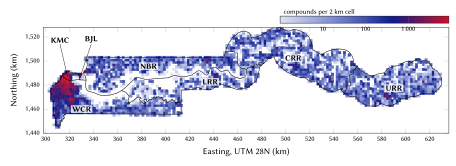
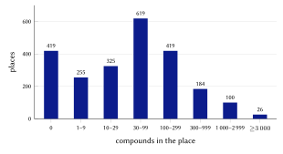
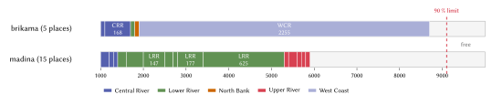
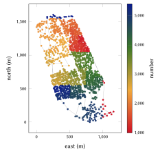
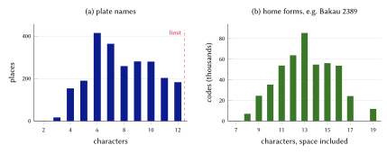
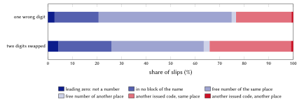
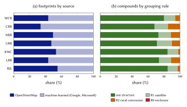

# Introduction

An address does two jobs. It lets a person or a vehicle find a door, and it lets an institution refer to that door in its records. In most of The Gambia neither job is done by a conventional street address. Outside a few colonial-era streets in Banjul and the streets now being named in Kanifing, few streets carry names on the ground and few doors carry numbers. Deliveries are guided by telephone, landmark by landmark; an ambulance crew depends on the caller's description; and a council identifies a rate-payer's compound by the proprietor's name [@jobe2026].

The Government's answer is the National Digital Addressing Policy of 2023, which adopts Plus Codes (the Open Location Code) as the national digital address [@mocde2023; @olc]. A Plus Code is computed from a position, needs no register and exists for every point in the country. Kanifing Municipal Council has tied the codes to its property-rates database [@jobe2026; @badji2025], and the Ministry of Communications and Digital Economy reports having digitised 34,464 addresses in Banjul and Kanifing [@dem2023]. What a Plus Code does not do well is what an address is used for most often in daily life: being said aloud, remembered after one hearing, and written on a parcel without a slip.

This report describes a model that keeps the Plus Code as the official address and adds, beside it, a *home code* for every compound: a place name people already say and a short number, such as **Bakau 2389**. The design problem is to make such a code unique in the whole country without a qualifier, although many Gambian place names repeat (*Madina* names fifteen places, *Brikama* five), and to make numbers follow the ground, so that a code also tells a courier roughly where along a lane a compound lies.

Our contributions are the following.

1. A complete addressing model whose every rule is stated as a formula: zones, the grouping of buildings into compounds, the place inventory and its short plate names, a phonetic name key, one national number range per name with disjoint blocks, Hilbert-curve numbering with insertion for new compounds, a Damm check digit and the computation of the official Plus Code (Section 4).
2. An implementation that a third party can run without our involvement: a standard-library reference engine with conformance vectors, the complete registry of 471,031 codes with every building footprint, and a registry server whose answers and issuing decisions are identical to those of the issuer (Section 5).
3. An evaluation on the full registry: uniqueness, decoding, code lengths, ordering locality, the consequences of typing errors, Plus Code accuracy, and a comparison with the 2024 census (Section 6), together with the designs we rejected and why (Section 7).
4. Estimates of the benefits for citizens, logistics, emergency services and government, each with its assumptions and a sensitivity range (Sections 8 to 11), followed by privacy and governance (Section 12) and limitations (Section 13).

# Background and related work

## Addressing in The Gambia

**The national digital address.** The National Digital Addressing Policy [@mocde2023], prepared for the Ministry of Communications and Digital Economy by the e-Governance Academy of Estonia, records that the Government "adopted and implemented a digital addressing system using the Google Plus Codes addressing solution" and gives the Gambia Postal Services Corporation (GAMPOST) the integration of the national system into its procedures and its door-to-door delivery. The Digital Addressing Initiative publishes the programme [@dai2026]. Addresses are written as a short code with the town, for example `F8HC+9G6 Bakau`.

**Council practice.** Kanifing Municipal Council implemented a Plus Code addressing system for about 500,000 residents between July 2021 and February 2022, georeferencing 36,000 properties, and uses it for waste management and property tax collection [@badji2025]. Its officials report that rate collectors previously identified compounds by their proprietors' names, that the codes are now linked to the rates database, that the council declined to replace them with simpler labels because those would lose accuracy, and that sequential street numbers are being introduced as a complement [@jobe2026]. In January 2023 the Ministry reported 34,464 addresses digitised across Banjul and Kanifing in a 2022 pilot, and 48,770 addresses identified in Kombo North, almost twice the number of properties in the Brikama Area Council database [@dem2023].

**Postcodes and door numbers.** The Gambia has no postcode system in use, and GAMPOST publishes no postcode list; addresses are written with the town. Door numbers are rare. In OpenStreetMap, 19 compounds carry a street and a house number [@osm]; the model shows those first, exactly as written.

**The census.** The 2024 Population and Housing Census counted 2,422,712 people, 297,581 households, 201,827 compounds and 547,528 buildings or structures, with an annual intercensal growth rate of 2.5 % since 2013 [@gbos2024]. Brikama local government area alone holds 47.5 % of the population. Enumeration areas are not open data; we use the census only as an external check on our counts (Section 6.7).

## International practice

The Universal Postal Union's S42 standard defines the components of postal addresses and country templates for rendering them [@upus42]. It describes how an address is written, not how a code is chosen where streets have no names. The World Bank's review of street-addressing programmes in 52 African cities between 1989 and 2004 found that, in a sample of 21 cities, only 8 % of streets had names before addressing, and that naming streets, numbering doorways and installing signs cost on average US$5.7 per addressed doorway [@farvacque2005]. Its central lesson for our work is that an address that people do not use decays: plates disappear and directions revert to landmarks.

National digital address systems in the region follow the grid approach. GhanaPostGPS, launched in 2017, divides the country into 5 m squares and gives each a code combining a regional prefix and a grid reference [@citifm2017]. The Gambia's choice of Plus Codes belongs to the same family: a code is computed from a position and needs no register.

## Code systems and why none suffices alone

Table 1 compares four kinds of address against the uses an address must serve. A grid code such as a Plus Code is computable, offline and open, but its symbols are hard to say and remember. Random-word systems [@w3w] name squares of a few metres with three dictionary words, which are easier to say, but they name squares rather than compounds, carry no sense of place, and depend on a proprietary word list. Street and door numbering is what people expect of an address, but it presupposes named streets that most of the country does not have [@farvacque2005]. A place name and a number is what Gambians already say ("in Bakau, near the…"); our task is to make it exact.

| Kind | Example | Said aloud | Remembered | Unique alone | Needs a register |
|:--|:--|:--|:--|:--|:--|
| Grid code (Plus Code) | `F8HC+9G6 Bakau` | hard: 8 symbols | hard | yes, with the town | no |
| Street and door number | `12 Atlantic Road` | easy | easy | with the town | yes, and named streets |
| Words for squares | three words | easy | medium | yes | yes, a word list |
| Place word and number | `Bakau 2389` | easy | easy | yes | yes, the registry |

: Kinds of address compared against the uses an address must serve.

Short-term memory holds about four chunks [@cowan2001]. Said aloud, a home code is a name and one or two groups of digits ("Bakau, twenty-three, eighty-nine"), within that span; a Plus Code is eight or more independent symbols.

# Data and sources

**Zones.** The seven code zones are the five regions, the City of Banjul and Kanifing Municipality. Their outlines are the OpenStreetMap boundary relations of administrative level 4 [@osm], taken whole and frozen at first issue (Figure 1).

**Places.** The place inventory combines OpenStreetMap places and GeoNames localities [@geonames]. Section 4.4 gives the rules that turn them into 2,347 places.

**Buildings.** The registry holds 672,836 building footprints: 296,550 from OpenStreetMap and 376,286 machine-learned footprints from Google Open Buildings [@sirko2021] and Microsoft's Global ML Building Footprints [@msbuildings], conflated through the Overture Maps buildings theme, which keeps community-mapped buildings first and fills the remainder with machine-learned outlines [@overture]. The share of each source varies by zone (Figure 8a): OpenStreetMap supplies 55 % of footprints in Banjul and 34 % in Central River.

**Facilities.** The access distances of Section 11 use the health facilities, schools, police stations and pharmacies on the N-Ways map, which combines OpenStreetMap points of interest with business listings; this layer is not part of the registry.

{#fig:zones width=100%}

| Index | Key | Zone | ISO 3166-2 | Compounds | Frame $F$ (km) |
|--:|:--|:--|:--|--:|--:|
| 0 | BJL | Banjul | GM-B | 4,320 | 7 |
| 1 | CRR | Central River | GM-M | 54,222 | 110 |
| 2 | KMC | Kanifing | none | 45,338 | 16 |
| 3 | LRR | Lower River | GM-L | 19,377 | 119 |
| 4 | NBR | North Bank | GM-N | 53,630 | 137 |
| 5 | URR | Upper River | GM-U | 48,103 | 83 |
| 6 | WCR | West Coast | GM-W | 246,041 | 111 |

: The seven zones with their issued codes and the side of their Hilbert frames. Kanifing Municipality has no ISO 3166-2 code of its own.

# The model

## Forms of a home code

A home code has four forms that map one to one (Table 3). Let $P$ be the place's plate name, $N$ its number, $Z$ the zone's name, $K$ the zone's key, $I$ the place's index in its zone and $c$ the check digit. Then

$$
\text{home} = P \;\, g(N), \qquad
\text{written} = \mathrm{upper}(P) \;\, g(N) \cdot \mathrm{upper}(Z), \qquad
\text{machine} = \texttt{GM-}K\texttt{-}I\texttt{-}N\texttt{-}c,
\tag{1}
$$

where $I$ is written with four digits and the grouping $g$ splits five-digit numbers for reading:

$$
g(N) =
\begin{cases}
N, & N < 10^4,\\
\lfloor N / 1000 \rfloor \;\, (N \bmod 1000), & N \ge 10^4 .
\end{cases}
\tag{2}
$$

| Form | Example | Who uses it |
|:--|:--|:--|
| Official address (the Government's) | `F8HC+9G6 Bakau` | shown first, everywhere |
| Home | `Bakau 2389` | people: said, typed, written on a parcel |
| Written | `BAKAU 2389 · KANIFING` | plates, stickers and forms |
| Machine | `GM-KMC-0001-2389-6` | applications, QR codes and partners |

: The forms of one code. Only the machine form carries the check digit.

The order of display is fixed: a council's street address where one exists, otherwise the Government's Plus Code of the compound's entrance with its town, and beside it the home code. The model issues no grid of its own and never presents a home code as the official address.

## Zones and frames

A point $p = (\varphi, \lambda)$ lies in the zone whose outline contains it, tested by ray casting. On an overlap the lowest index wins; a point in no outline (a river bank, the shore) takes the zone with the nearest outline vertex within 2 km:

$$
\mathrm{zone}(p) =
\begin{cases}
\min\{\, i(z) : p \in \Omega_z \,\}, & \text{if some outline } \Omega_z \ni p,\\
\arg\min_z \min_{v \in \partial\Omega_z} \lVert u(p) - u(v) \rVert, & \text{if that distance} \le 2000\ \text{m},\\
\text{none}, & \text{otherwise},
\end{cases}
\tag{3}
$$

where $u$ is the projection to WGS 84 / UTM zone 28N (Section 4.12) and $v$ runs over the outline's vertices.

Each zone carries a square frame used only to order compounds (Section 4.8). With $E$ and $N$ the projected coordinates of the zone's outline, the frame's south-west corner and side are

$$
E_0 = 1000 \left\lfloor \frac{\min E}{1000} \right\rfloor, \quad
N_0 = 1000 \left\lfloor \frac{\min N}{1000} \right\rfloor, \quad
F = 1000 \left\lceil \frac{\max(\max E - E_0,\ \max N - N_0)}{1000} \right\rceil .
\tag{4}
$$

Kanifing's frame starts at $E_0 = 313\,000$ m, $N_0 = 1\,483\,000$ m and has side $F = 16$ km.

## Compounds

The unit of address is the compound: the plot that one gate serves. Footprints are grouped by four rules applied in order, with a union--find structure so that the result does not depend on the order of the input. A structure is *urban* when its 250 m tile holds at least 100 structures (1,600 per km²). The gap between two structures $a$ and $b$ with centres $\mathbf{c}_a, \mathbf{c}_b$ and areas $A_a, A_b$ is the distance between centres less the radii of circles of the same areas:

$$
\gamma(a, b) = \lVert \mathbf{c}_a - \mathbf{c}_b \rVert - \sqrt{A_a / \pi} - \sqrt{A_b / \pi} .
\tag{5}
$$

| Rule | Condition | Effect | Compounds |
|:------------|:--------------------------|:-------------------|---------:|
| R0 enclosure | centre inside a mapped walled site or compound | all its structures form one compound | 600 |
| R1 satellite | $A < 30$ m² and $\gamma \le 4$ m (urban) or $\le 8$ m (rural) to a structure of at least 30 m² | joins that compound | 70,040 |
| R2 rural concession | rural; both $A < 120$ m²; $\gamma \le 6$ m | single-linkage clusters of at most 30 | 37,245 |
| none | | the structure is its own compound | 363,145 |

: Grouping rules and the number of first-issue compounds each formed.

Two main structures in urban fabric are never merged by shape alone: in Serrekunda and Brikama, houses built wall to wall are separate compounds unless a wall is mapped or residents say otherwise. Of the 471,031 codes, 107,632 have more than one structure (70,813 two, 19,254 three, 17,565 four or more). A compound's centre is the area-weighted centroid of its structures; its entrance is a mapped gate on its enclosure where one exists (17 today), otherwise its centre.

Each structure also carries a use class with a confidence and the evidence for it, following a ladder: OpenStreetMap tags, then N-Ways places inside the footprint, then shape [@osm]. Heights distributed with machine-learned footprints are rendering values rather than measurements and are not used. The main structure is a house in 370,331 compounds, a family compound in 44,230 and a hut in 33,223; 21,770 remain unclassified. Class identifiers such as `res.maison` are stable codes of the published data.

## Places

The place word is a town, village, suburb or neighbourhood that people say. The inventory is built in five steps.

1. *Landmarks out.* A name containing *point, island, roundabout, junction, traffic light, bridge, wharf, ferry, crossing, market* or *airport* names no home; 41 were removed. Without this rule *Dockyard Point* would name much of Banjul, and *Sukuta Traffic Light* 4,780 homes in Sukuta.
2. *Duplicates.* A place mapped twice (a point and an area within 1 km with the same name key) keeps its first identifier (140 cases). A GeoNames locality is dropped when an OpenStreetMap place lies within 300 m, or within 1 km with the same name key (279 cases).
3. *Brackets.* A second name in brackets becomes an alias: *Busura (Kunkujang)* is *Busura*, and typing *Kunkujang* finds it.
4. *Index.* Within each zone, places are sorted by name key, then identifier, and numbered from 0. The index is frozen.
5. *Point to place.* A compound $c$ takes the nearest place of any kind within 2.5 km; else the nearest town or city within 10 km; else the nearest place of its zone, ties going to the lower index:

$$
\mathrm{place}(c) =
\begin{cases}
\arg\min_{q \in \mathcal{P}(z)} d(c, q), & \text{if } \min_{q \in \mathcal{P}(z)} d(c,q) \le 2500\ \text{m},\\
\arg\min_{q \in \mathcal{T}(z)} d(c, q), & \text{if } \min_{q \in \mathcal{T}(z)} d(c,q) \le 10\,000\ \text{m},\\
\arg\min_{q \in \mathcal{P}(z)} d(c, q), & \text{otherwise},
\end{cases}
\tag{6}
$$

where $\mathcal{P}(z)$ is the set of places of zone $z$, $\mathcal{T}(z) \subseteq \mathcal{P}(z)$ its towns and cities, and $d$ the distance in UTM metres.

The result is 2,347 places: 1,187 localities, 1,072 villages, 38 suburbs, 27 towns, 18 neighbourhoods and 5 cities. The median place has 42 compounds; 419 places have none today, mostly hamlets whose buildings are not yet mapped, and keep their blocks for when they are (Figure 2).

{#fig:places width=72%}

## Plate names

The name in the code must be short enough to say and to paint: at most 12 characters (letters, spaces and hyphens each count one; an accented letter counts one) and two words, linking words (*and, of, the*) not counted. A trailing number counts in the characters only, as in *Brusubi 1*:

$$
\mathrm{ok}(s) \iff \lvert \mathrm{NFC}(s) \rvert \le 12 \;\wedge\; \lvert \mathrm{words}(s) \setminus L \rvert \le 2 ,
\tag{7}
$$

where $L$ is the set of linking words. A name that fails is shortened in three steps: a trailing number is set aside; generic words (*village, ward, town, settlement, area, layout, quarters, island, point, wharf, phase, roundabout*) are removed; and if the name still does not fit, every run of one or two whole words that fits is a candidate, and the candidate whose words are rarest across all Gambian place names is chosen:

$$
r(x) = \frac{1}{\lvert \mathrm{words}(x) \rvert} \sum_{w \in \mathrm{words}(x)} f(w), \qquad
\mathrm{plate}(s) = \arg\min_x \big( r(x),\, -\lvert \mathrm{words}(x) \rvert,\, -\lvert x \rvert \big),
\tag{8}
$$

with $f(w)$ the number of Gambian place names that contain $w$ and the minimum taken in lexicographic order. *Balanghar Kerjuri* thus becomes *Kerjuri*: six villages are *Balanghar* something, only one is *Kerjuri*. In all, 1,772 names are used as they are, 3 are cleaned of generic words, and 572 (24.4 %) carry a provisional plate name chosen by Eq. (8), with up to three candidates, for their council to confirm. Their codes are issued now; if a council chooses another short name, the name may change once and the number never does, and the official name always stays an alias.

## The name key

Two places whose names sound or look alike must never be distinguished by the listener alone. They share one *name key* $\kappa$, and every place with the same key shares one national number range (Section 4.7). The key is a fixed composition of foldings,

$$
\kappa = \tau_{e} \circ \sigma \circ \phi \circ \beta \circ \ell \circ \theta \circ \pi \circ \alpha ,
\tag{9}
$$

applied right to left, with the steps defined in Table 5.

| Step | Rule | Example |
|:--------|:--------------------------------|:-----------------|
| $\alpha$ letters | ñ → ny, ŋ → ng; accents and case removed | Ñaama → nyaama |
| $\pi$ split | hyphens, apostrophes, dots and brackets become spaces | Serre-Kunda → serre kunda |
| $\theta$ tail | a trailing number and *no, number, village, ward* dropped | Bakoteh 2 → bakoteh |
| $\ell$ lead | *the, village, of* dropped when more follows | Village of Jola → jola |
| $\beta$ ker | *kerr, keur, kerre* → *ker*; spaces removed | Keur Mbaye → kermbaye |
| $\phi$ fold | ou, oo → u; ee → i; dj → j; kh → k; ph → f; th → t; c before e, i, y → s; ck, c, q → k; y → i; h dropped | Kerr Mbaye → kermbai |
| $\sigma$ collapse | doubled letters become one | Sukkuta → sukuta |
| $\tau_e$ trim | a final *e* after two letters is dropped | Ndungu Kebbe → ndungukeb |

: The foldings that make up the name key, Eq. (9).

So *Serrekunda* = *Serre Kunda*, *Kerr Mbaye* = *Keur Mbaye*, *Sukuta* = *Sukkuta* and *Ndungu Kebbeh* = *Ndungu Kebbe*, while *Bakau* ≠ *Bakoteh*. The folding errs on the generous side deliberately: joining two names that differ costs only a longer number range, whereas separating two names that sound alike would give two homes the same spoken code. Every official name and bracketed second name is an alias of its place; an alias whose key equals another place's key, or that two places claim, is dropped (16 were), since otherwise *Tukulorr*, an old name of Porli Nyangen, would decode to the village of Tukulor.

The 2,347 places fold to 1,854 name keys. Of these, 298 keys are shared, by 791 places in all; the most repeated are *Madina* (15 places), *Amdalai* (10) and *Kerewan*, *Misira* and *Nema* (9 each).

## One national range per name

A home code is said without its town, so all places that share a name key draw their numbers from one national range for that name, cut into one block per place. Because a number falls in exactly one block, a name and a number decode to exactly one place.

**Block size.** A place with $n$ compounds receives a block of three times its compounds, rounded up to the grain $g_d$ of a $d$-digit range and at least one grain:

$$
b(n, d) = g_d \cdot \max\!\left(1, \left\lceil \frac{3n}{g_d} \right\rceil\right), \qquad g_3 = 10,\quad g_4 = g_5 = 100 .
\tag{10}
$$

At the national intercensal growth rate of 2.5 % a year [@gbos2024] a place triples in $t = \ln 3 / \ln 1.025 \approx 44$ years; at 3.7 %, the pace of the fastest-growing towns in the region, in about $\ln 3 / \ln 1.037 \approx 30$ years.

**Number length.** The $k$ places of one name share one length $d$, the smallest of 3, 4 and 5 for which their blocks fill at most 90 % of the range, so that a tenth always stays free for new places of the same name:

$$
d^{*} = \min \left\{ d \in \{3,4,5\} : \sum_{i=1}^{k} b(n_i, d) \le 0.9 \cdot 9 \cdot 10^{d-1} \right\}, \qquad
\mathcal{R}_d = [\,10^{d-1},\ 10^{d} - 1\,] .
\tag{11}
$$

A three-digit range thus has 900 numbers of which 810 can be allocated, a four-digit range 9,000 and 8,100, and a five-digit range 90,000 and 81,000. A place alone with its name has three digits up to 270 compounds, four up to 2,700 and five up to 27,000.

**Blocks.** Blocks are cut from the bottom of the range in the order (zone key, place index):

$$
\ell_1 = 10^{d-1}, \qquad h_i = \ell_i + b(n_i, d) - 1, \qquad \ell_{i+1} = h_i + 1 .
\tag{12}
$$

*Worked example: Bakau.* Bakau is alone with its name and had $n = 1455$ compounds at first issue. Three digits would need $3 \times 1455 = 4365 > 810$ numbers, so $d = 4$, and Eq. (10) gives $b = 100 \lceil 4365/100 \rceil = 4400$: the block is 1000--5399.

*Worked example: Brikama.* Five places fold to *brikama* (Table 6). Their three-digit blocks would need 7,460 numbers, more than 810; their four-digit blocks need 7,700, within 8,100. Every Brikama therefore has four digits, and the number alone says which one is meant: *Brikama 1001* is in Central River and *Brikama 7042* in West Coast (Figure 3).

| Place | Zone | $n_i$ | $b(n_i,3)$ | $b(n_i,4)$ | Block |
|:--|:--|--:|--:|--:|:--|
| Brikama | Central River | 32 | 100 | 100 | 1000--1099 |
| Brikama Nding | Central River | 168 | 510 | 600 | 1100--1699 |
| Brikama | Lower River | 14 | 50 | 100 | 1700--1799 |
| Brikama | North Bank | 9 | 30 | 100 | 1800--1899 |
| Brikama | West Coast | 2,255 | 6,770 | 6,800 | 1900--8699 |
| Sum | | | 7,460 | 7,700 | |

: The *brikama* name family: Eqs. (10) and (11) applied to its five places.

{#fig:blocks width=100%}

**Frozen.** The block table is frozen at first issue. A block is never moved, renumbered or shrunk; a new place of an existing name takes a block from the top of the name's free space; a full place takes a further block of one grain (Section 4.8). Of the 471,031 codes, 87,662 (18.6 %) have three digits, 251,933 (53.5 %) four and 131,436 (27.9 %) five. The largest place, Suware in West Coast, has 6,928 compounds and the block 10600--31399. No name needs more than five digits and none needs a qualifier. Five small names (*Babilon*, *Dobang*, *Kenaba* and *Suruwa* at three digits, *Ganatown* at four) have reached the 90 % limit; a further place of the same name would need the next length or a qualifier agreed with its council.

## Numbering along a Hilbert curve

Within its block a place's compounds are numbered along a Hilbert curve [@hilbert1891], so that neighbours on the ground receive neighbouring numbers, as house numbers do along a street. The Hilbert curve preserves locality better than row-by-row or Morton (Z-order) orderings [@moon2001]; Section 6.4 measures this on the registry.

**Cells.** The zone's frame is divided into $2^{16} \times 2^{16}$ cells of side $s = F / 2^{16}$ (0.24 m in Kanifing). A compound's centre $(E, N)$ falls in the cell

$$
x = \min\!\left(2^{16} - 1,\ \max\!\left(0, \left\lfloor \frac{E - E_0}{s} \right\rfloor\right)\right), \qquad
y = \min\!\left(2^{16} - 1,\ \max\!\left(0, \left\lfloor \frac{N - N_0}{s} \right\rfloor\right)\right) .
\tag{13}
$$

**Index.** The Hilbert index $H(x, y)$ is accumulated from the most significant level down. For $m = 2^{15}, 2^{14}, \dots, 1$, with $r_x = 1$ if the bit $m$ of $x$ is set and 0 otherwise (likewise $r_y$),

$$
H \leftarrow H + m^2 \cdot \big( (3 r_x) \oplus r_y \big), \qquad
(x, y) \leftarrow
\begin{cases}
(m - 1 - y,\ m - 1 - x), & r_y = 0,\ r_x = 1,\\
(y, x), & r_y = 0,\ r_x = 0,\\
(x, y), & r_y = 1,
\end{cases}
\tag{14}
$$

where $\oplus$ is the bitwise exclusive or. Consecutive indices are adjacent cells, so sorting by $H$ keeps neighbours together.

**First issue.** The $n$ compounds of a place with block $[\ell, h]$ are sorted by $(H, E, N)$, and the compound of rank $i$ (from 0) receives

$$
N_i = \ell + \left\lfloor \frac{(i + \tfrac{1}{2})(h - \ell + 1)}{n} \right\rfloor .
\tag{15}
$$

Because a block is three times its compounds, consecutive numbers are about three apart, leaving two free numbers between neighbours.

*Worked example: Bakau 2389.* The compound's centre projects to $E = 318\,287.3$ m, $N = 1\,490\,662.9$ m in Kanifing's frame, with Hilbert index $H = 745\,833\,093$. It is the 460th of Bakau's 1,455 first-issue compounds along the curve ($i = 459$), so by Eq. (15)

$$
N_{459} = 1000 + \left\lfloor \frac{459.5 \times 4400}{1455} \right\rfloor = 1000 + \lfloor 1389.56 \rfloor = 2389 .
\tag{16}
$$

Its neighbours along the curve are 2386 and 2392. Figure 4 shows the whole of Bakau coloured by number.

{#fig:bakau width=62%}

**After first issue.** A new compound with index $H$ takes the free number midway between its Hilbert neighbours $a$ (the issued number just before $H$ in the place's first block) and $b$ (just after):

$$
N_{\text{new}} =
\begin{cases}
\lfloor (a + b) / 2 \rfloor, & \text{if } b - a \ge 2 \text{ and it is free},\\
\text{the lowest free number of the further blocks}, & \text{else, if one exists},\\
\text{the first number of a new block of one grain}, & \text{otherwise}.
\end{cases}
\tag{17}
$$

A new block is taken from the name's free space. If the name's range has no free space left, no code is issued until the council names an extension of the place, which then receives its own block. No issued number ever changes, and a retired number is never given again. A house built between Bakau 2389 and Bakau 2392 receives $\lfloor (2389 + 2392)/2 \rfloor = 2390$.

## Decoding without context

To decode a typed or spoken home code, the engine reads the trailing digits as the number $D$ and the words before them as the name $P$. It folds the name to its key and finds every name family the key belongs to, by plate name or by alias. For each family with length $d(q)$ it takes the last $d(q)$ digits of $D$ as the number and finds the one block that holds it:

$$
\mathrm{decode}(P, D) = \big\{ (q, N) : \kappa(P) \in \mathrm{keys}(q) \cup \mathrm{aliases}(q),\ N = D \bmod 10^{d(q)},\ N \in \mathrm{blocks}(q) \big\} .
\tag{18}
$$

Because the blocks of one name are disjoint, at most one place of a family holds a given number, so decoding is unique. A zone name after a comma, and a check digit that a system may send after another comma, are verified but never used to re-route a code. Section 6.1 tests Eq. (18) on every issued code.

## The check digit

The machine form carries one check digit, for systems only. It is computed by Damm's algorithm [@damm2004; @damm2007] over a ten-digit payload, the name family's identifier $\Phi$ in five digits followed by the number in five digits:

$$
\delta = \Phi_5 \,\Vert\, N_5, \qquad c_0 = 0, \qquad c_k = T[c_{k-1}][\delta_k] \ \ (k = 1, \dots, 10), \qquad c = c_{10},
\tag{19}
$$

where $T$ is the table of a totally anti-symmetric quasigroup of order 10:

$$
T = \begin{array}{c|cccccccccc}
 & 0 & 1 & 2 & 3 & 4 & 5 & 6 & 7 & 8 & 9\\ \hline
0 & 0 & 3 & 1 & 7 & 5 & 9 & 8 & 6 & 4 & 2\\
1 & 7 & 0 & 9 & 2 & 1 & 5 & 4 & 8 & 6 & 3\\
2 & 4 & 2 & 0 & 6 & 8 & 7 & 1 & 3 & 5 & 9\\
3 & 1 & 7 & 5 & 0 & 9 & 8 & 3 & 4 & 2 & 6\\
4 & 6 & 1 & 2 & 3 & 0 & 4 & 5 & 9 & 7 & 8\\
5 & 3 & 6 & 7 & 4 & 2 & 0 & 9 & 5 & 8 & 1\\
6 & 5 & 8 & 6 & 9 & 7 & 2 & 0 & 1 & 3 & 4\\
7 & 8 & 9 & 4 & 5 & 3 & 6 & 2 & 0 & 1 & 7\\
8 & 9 & 4 & 3 & 8 & 6 & 1 & 7 & 2 & 0 & 5\\
9 & 2 & 5 & 8 & 1 & 4 & 3 & 6 & 7 & 9 & 0
\end{array}
\tag{20}
$$

Because each row and column of $T$ is a permutation, every single wrong digit changes $c$; because $T$ is totally anti-symmetric, that is $T[T[c][x]][y] = T[T[c][y]][x]$ implies $x = y$, every swap of two adjacent different digits changes it too. The reference engine's self-test checks both properties exhaustively on 3,000 random payloads.

*Worked example.* Bakau's family identifier is $\Phi = 75$, so the payload of Bakau 2389 is $\delta = 0007502389$. The intermediate values $c_1, \dots, c_{10}$ are $0, 0, 0, 6, 2, 4, 2, 6, 3, 6$, and the check digit is $c = 6$: `GM-KMC-0001-2389-6`. The check digit binds the name and the number, and the place follows from the block table. It is not printed on plates or shown to people: its only purpose is to catch transcription errors between systems.

## The official address: the Plus Code

The Plus Code of a point is computed, not issued [@olc]. Latitude and longitude in WGS 84 degrees are shifted to positive values, $\varphi' = \varphi + 90$ and $\lambda' = \lambda + 180$, and written in base 20 with the alphabet `23456789CFGHJMPQRVWX`. For the five pairs $k = 1, \dots, 5$ with resolutions $\rho_k = 20^{2-k}$ degrees,

$$
a_k = \left\lfloor \frac{\varphi'}{\rho_k} \right\rfloor \bmod 20, \qquad
o_k = \left\lfloor \frac{\lambda'}{\rho_k} \right\rfloor \bmod 20,
\tag{21}
$$

and the eleventh symbol splits the last cell into 5 rows and 4 columns:

$$
q = 4 \left( \left\lfloor \frac{5\varphi'}{\rho_5} \right\rfloor \bmod 5 \right) + \left( \left\lfloor \frac{4\lambda'}{\rho_5} \right\rfloor \bmod 4 \right) .
\tag{22}
$$

The code is the ten pair symbols with a "+" after the eighth, followed by the eleventh. An eleven-symbol code names a cell of $\rho_5/5$ by $\rho_5/4$, about 2.8 m by 3.4 m at The Gambia's latitude.

*Worked example.* The entrance of Bakau 2389 is at $\varphi = 13.47841$, $\lambda = -16.6787355$, so $\varphi' = 103.47841$ and $\lambda' = 163.3212645$. Eq. (21) gives the pairs $(5,8), (3,3), (9,6), (11,8), (7,10)$, written `7C`, `55`, `F8`, `HC`, `9G`, and Eq. (22) gives $q = 4$, written `6`: the full code is `7C55F8HC+9G6`. The short form drops the first four symbols, which are shared across Greater Banjul, and is written with the town, `F8HC+9G6 Bakau`, as the Government publishes it (Figure 5). A short code is made whole again from the town's position by the specification's recovery rule. The engine reproduces the specification's reference value (`8FVC9G8F+6X` for a point in Zürich) and its recovery examples.

{#fig:spot width=58%}

## The projection

Distances, Hilbert frames and grouping rules are computed in WGS 84 / UTM zone 28N (EPSG:32628). The Gambia lies close to the zone's central meridian, $\lambda_0 = -15°$, and its eastern end lies 1.25° east of it, so the projection's scale error inside the country stays below 0.1 %. The engine uses Krüger's series to fourth order in the third flattening $n$ [@karney2011]:

$$
n = \frac{f}{2 - f}, \qquad
A = \frac{a}{1 + n}\left(1 + \frac{n^2}{4} + \frac{n^4}{64}\right), \qquad
e = \frac{2\sqrt{n}}{1 + n},
\tag{23}
$$

$$
t = \sinh\!\big(\operatorname{artanh}(\sin\varphi) - e \operatorname{artanh}(e \sin\varphi)\big), \qquad
\xi' = \operatorname{atan2}\!\big(t, \cos(\lambda - \lambda_0)\big), \qquad
\eta' = \operatorname{artanh}\!\frac{\sin(\lambda - \lambda_0)}{\sqrt{1 + t^2}},
\tag{24}
$$

$$
\begin{gathered}
\xi = \xi' + \sum_{j=1}^{4} \alpha_j \sin(2j\xi') \cosh(2j\eta'), \qquad
\eta = \eta' + \sum_{j=1}^{4} \alpha_j \cos(2j\xi') \sinh(2j\eta'), \\
E = E_{\mathrm{F}} + k_0 A \eta, \qquad N = k_0 A \xi,
\end{gathered}
\tag{25}
$$

with $a$ and $f$ the WGS 84 semi-major axis and flattening, $\alpha_1, \dots, \alpha_4$ Krüger's coefficients in $n$, $k_0 = 0.9996$ and $E_{\mathrm{F}} = 500\,000$ m. Here $A \approx 6\,367\,449.146$ m and $n \approx 0.0016792$. The inverse uses the matching $\beta$ and $\delta$ series; the self-test checks that 2,000 random points in the country return to within $10^{-9}$ degrees.

# Implementation

## Reference engine and conformance vectors

The normative specification is `engine/SPEC.md`; its executable reference is `engine/reference/gm_engine.py`, written for Python 3.9 or later with the standard library only. The engine implements every equation of Section 4. Its self-test covers the projection round trip, the two Damm properties, name-key equalities and inequalities, Plus Code encoding, decoding and recovery against the specification's examples and 2,000 random round trips, the disjointness of every name's blocks, and the unique decoding of a number in each of the 2,347 places. The file `vectors.json` holds conformance vectors (Plus Codes of public places, check digits, spoken numbers, name-key pairs, decodings of repeated names and plate names); any implementation must reproduce them value for value. The issuer's production service implements the same specification; Section 5.4 reports the tests of parity between the two.

## The registry

The registry in `registry/` is the complete record of issued codes. Each zone has a file of codes, with one row per code: its forms, place, number and check digit, status, issue mode and time, entrance and its kind, Plus Code, use class and compound profile, official address where one exists, the compound's centre from which numbers are ordered, and its grouping rule. A second file per zone holds every structure with its class, confidence, source, size and footprint geometry. The place table `lieux.csv.gz` lists every place with its blocks, name key, family, digits, aliases and position. `MANIFEST.json` gives the counts and the SHA-256 digest of every uncompressed file. Nothing is withheld: all 471,031 codes and all 672,836 footprints are published.

## The registry server and API

A registry is useful to a ministry, a post office or a developer only if it can be served. The repository therefore includes `server/`, a deployable HTTP service written with the Python standard library that reuses the reference engine for every rule. It imports the registry into SQLite, verifying every digest and count and refusing a mismatch; serves a JSON API under `/v1`; and exports the registry back to the published format, byte for byte. Table 7 lists the endpoints; `docs/api.md` gives a real request and response for each, and `server/openapi.yaml` the formal contract. With Docker the whole deployment is `docker compose up`. On the full registry the import takes about 18 s and produces a 524 MB database, and an export is byte-identical to the published files.

| Endpoint | Purpose |
|:--|:--|
| `GET /v1/health`, `GET /v1/info` | status, counts, licences, credit line |
| `GET /v1/codes/{machine}` | the full card of a code |
| `GET /v1/find?q=` | any form of a code, a Plus Code, or an official address |
| `GET /v1/at?lat=&lng=`, `GET /v1/near` | the code at a point; codes within 500 m |
| `GET /v1/verify?code=` | syntax, check digit and issue status |
| `GET /v1/spot`, `GET /v1/spot/decode` | Plus Code of a point; codes in a Plus Code cell |
| `GET /v1/zones`, `GET /v1/zones/{key}`, `…/codes` | zones, their places, paged codes |
| `GET /v1/areas?name=`, `GET /v1/areas/{id}` | places by name or identifier, with blocks |
| `POST /v1/codes`, `PATCH /v1/codes/{machine}` | issue a code; confirm, retire or move an entrance |

: Endpoints of the registry server.

Issuing follows the issuer's rules exactly: a point within 3 m of an issued entrance, or an outline overlapping an issued footprint, already has a code; an outline must enclose between 12 m² and 2 ha; the place is the nearest by Eq. (6); the number follows Eq. (17), cutting new blocks when needed; a new code is provisional and issued on demand; and each key has a daily limit. A deployment issues codes only when the State or N-WAYS LIMITED has designated it as the country's issuer; every other deployment runs read-only. Two independent issuers would sooner or later give the same number to two homes.

## Parity with the issuer

We tested the server against the issuer's own implementation. Five hundred issues in sequence across all seven zones, 139 of them after extension blocks had been cut, produced identical numbers, forms and blocks. Three hundred random points gave the same answer to the point query as the issuer's live service, distances included. Two random samples of 51 codes matched the issuer's code cards field by field, 1,020 fields per sample, with no difference. Seventy-two of these cases are kept as test fixtures and replayed by the server's tests.

# Evaluation

All measures in this section are computed from the published registry by `tools/paper_data.py`, which also writes the data behind every figure.

## Uniqueness and decoding

The 471,031 codes have 471,031 distinct home forms (compared without regard to case), and therefore also distinct machine forms. Decoding each home form with Eq. (18), with no zone, town or position given, returned exactly one result for every code, and that result was the code itself. Without the national ranges, if each place numbered its compounds independently from the bottom of its own range, 17,183 codes would share their home form with a code in another place of the same name; 165,538 codes (35.1 %) lie in places whose name repeats somewhere else in the country.

## Lengths

Plate names have between 2 and 12 characters, with a median of 8 (Figure 6a). Home forms have between 7 and 19 characters including spaces, with a median of 13 (Figure 6b). The longest arise from two-word plate names with five-digit numbers, such as *Sinchu Alagi* and *Manjai Kunda*. Of all codes, 72.1 % have a three- or four-digit number.

{#fig:lengths width=100%}

## Coverage

Every compound formed from the 672,836 footprints holds a code, in all seven zones. Of the 2,347 places, 1,928 hold at least one code and 419 hold none yet. Nineteen codes carry a council street address as their official address and 17 lead to a mapped gate; the remainder lead to the compound's centre until a gate is confirmed.

## Ordering locality

We ordered the compounds of every place in three ways on the same $2^{16} \times 2^{16}$ grid and measured the distance between compounds with consecutive ranks, over 469,103 consecutive pairs (Table 8). The Hilbert ordering has the shortest steps at every quantile: its median step of 27.0 m is 12 % shorter than Morton order and seven times shorter than row order, and its 90th percentile is less than a tenth of row order's. In Bakau the median step between consecutive numbers is 20.8 m, against a median distance of 14.2 m from each compound to its nearest neighbour.

| Ordering | Median (m) | Mean (m) | 90th percentile (m) |
|:--|--:|--:|--:|
| Hilbert curve (used) | 27.0 | 53.1 | 81.7 |
| Morton (Z-order) curve | 30.8 | 65.7 | 114.1 |
| Rows (north, then east) | 186.9 | 339.0 | 840.5 |

: Distance between compounds with consecutive ranks within a place, by ordering.

## Typing and listening errors

We applied every single-digit substitution and every transposition of two adjacent different digits to the number of every issued home code (17.35 million substitutions and 1.31 million transpositions) and decoded the result by Eq. (18). Figure 7 shows the outcomes. A substitution produces a number with a leading zero in 2.7 % of cases, falls in no block of the name in 18.0 %, and falls on a free number in 56.0 %; in all these cases the code is refused. It lands on another issued compound of the same place in 22.6 % and of another place of the same name in 0.7 %. The rate of 23.4 % is below the value of about one third that the block headroom alone would suggest, because numbers outside all blocks and leading zeros absorb part of the errors. Transpositions land on another issued code more often (34.1 %), because they keep the digits close to the original.

{#fig:slips width=100%}

These residual errors are handled by two mechanisms. Before routing, applications show the place and zone of the decoded code, so that a slip landing in another place (*Brikama, Central River* instead of *Brikama, West Coast*) is visible to the caller. Between systems, the machine form's check digit detects every single substitution and every adjacent transposition, as Section 4.10 guarantees; swapping the last two digits of `GM-KMC-0001-2389-6`, for example, gives `GM-KMC-0001-2398-6`, whose check digit should be 7, so the code is refused.

## Plus Code accuracy

For every one of the 471,031 codes, encoding the published entrance point gives the published Plus Code, and recovering its short form from the position of the code's place gives the full code again. The official address can therefore be reproduced from the registry and from the town written after it.

## Comparison with the 2024 census

Table 9 compares the registry with the census counts by local government area [@gbos2024]; the zones coincide with the areas, except that Central River combines Kuntaur and Janjanbureh. The registry holds 1.23 footprints per census structure but 2.33 codes per census compound. The ratio is lowest in Kanifing (1.62) and Banjul (1.95), and highest in Upper River (3.10). In Banjul and Kanifing the registry holds fewer codes than households, because several households share one building.

| Zone | LGA | Households | Compounds | Codes | Ratio | Structures | Footprints |
|:-----|:-------------|---------:|---------:|---------:|------:|---------:|---------:|
| BJL | Banjul | 5,551 | 2,220 | 4,320 | 1.95 | 6,439 | 5,661 |
| KMC | Kanifing | 61,586 | 27,922 | 45,338 | 1.62 | 82,216 | 55,544 |
| WCR | Brikama | 147,611 | 106,183 | 246,041 | 2.32 | 222,898 | 319,487 |
| LRR | Mansakonko | 10,858 | 7,963 | 19,377 | 2.43 | 23,796 | 28,665 |
| NBR | Kerewan | 25,891 | 21,115 | 53,630 | 2.54 | 67,527 | 84,169 |
| CRR | Kuntaur, Janjanbureh | 25,470 | 20,931 | 54,222 | 2.59 | 81,641 | 100,269 |
| URR | Basse | 20,614 | 15,493 | 48,103 | 3.10 | 63,011 | 79,041 |
| Total | | 297,581 | 201,827 | 471,031 | 2.33 | 547,528 | 672,836 |

: The registry against the 2024 census by local government area (LGA). Households, compounds and structures are census counts; codes and footprints are the registry's; the ratio is codes per census compound.

The census compound is a social unit, often a walled family plot with several houses tens of metres apart. The registry's compound is a physical unit inferred from footprints: grouping rule R2 joins only small structures within 6 m, and rule R0 applies only where a wall is mapped, which is the case for 600 compounds. The registry is therefore finer than the census, and more so in rural zones, where family compounds are large and walls are rarely mapped. A finer unit does no harm to finding a door, because every code still leads to a building of the compound. It does mean that a family compound may hold several codes. Section 13 describes how these are reconciled.

## Footprints and grouping by zone

Figure 8 shows, by zone, the source of the footprints and the rule that formed each compound. Rural concessions (rule R2) make up 15 % of compounds in Central River and 12 % in North Bank, and about 2 % in Banjul and Kanifing, where urban fabric prevents merging by shape. Machine-learned footprints form the majority everywhere except Banjul and Kanifing.

{#fig:sources width=100%}

# Designs considered and rejected

The model of Section 4 was not our first design. We record the alternatives, the measurements that decided between them, and the errors we found during development, so that a successor can see the reasons as well as the result.

## Forms

| Option | Example | Reason for rejection |
|:--------------------|:--------------|:------------------------------|
| Replace the Plus Code with a home code | `Bakau 2389` alone | the Government's address must come first; a home code complements it |
| Show the Plus Code only | `F8HC+9G6 Bakau` | eight symbols mixing letters and digits are hard to say and remember (Table 1) |
| A national digits-only code | `07 5023 89` | carries no place, and a wrong digit lands on a real home elsewhere |
| A region and a number | `Kanifing 48213` | five or six digits in the large zones; people describe their home by town, not region |
| A place and a number with the region to separate repeated names | `Brikama 1001, Central River` | not unique on its own; 165,538 codes lie in repeated names |
| A place and a number from one national range per name | `Bakau 2389` | adopted |

: Forms considered.

Only the adopted form is short, says where the home is, and is unique in the whole country without a qualifier.

## Check digit

A check letter computed by ISO/IEC 7064 MOD 11-2 [@iso7064] needs an eleventh symbol, and spoken English letter names rhyme (B, C, D, E, G, P, T, V, Z). Verhoeff's dihedral-group scheme [@verhoeff1969] detects the same error classes as Damm's but needs a permutation table in addition to the multiplication table. Damm's algorithm uses one table, needs only the ten digits, and detects every single wrong digit and every adjacent transposition [@damm2007]. We also considered showing the check digit to people and rejected it: it lengthens the spoken code by a symbol that carries no meaning, and Section 6.5 shows that a displayed place and zone catch most slips before a route is taken.

## Ordering

Section 6.4 compares three orderings on the full registry. Row order was rejected because consecutive numbers lie a median of 187 m apart, so a number says little about where in a place a compound lies. Morton order is simpler to compute than the Hilbert curve but jumps at quadrant boundaries, which lengthens its 90th-percentile step by 40 %.

## Errors found during development

- *Landmarks as places.* The first inventory named homes after *Dockyard Point* and *Sukuta Traffic Light* (4,780 homes). Landmark words are now excluded (Section 4.4).
- *A town named after the village beside it.* Under an earlier rule that gave villages within 2.5 km priority over towns, central Farafenni took a neighbouring village's name. The issue was withdrawn before publication; Eq. (6) now takes the nearest place of any kind within 2.5 km, so the town centre carries *Farafenni*.
- *Colliding aliases.* *Tukulorr* folded to the key of *Tukulor*. Aliases that collide are now dropped (16 were).
- *A transcription error in Damm's table.* One row of $T$ was mistyped during development and was caught by the exhaustive self-test before any code was issued.

# Benefits for citizens

A home code changes four ordinary matters for a household in Bakau, Brikama or Basse.

**Being found.** A visitor, a taxi or a delivery rider is today guided by telephone, landmark by landmark. With a code, the resident gives one short phrase ("Bakau, twenty-three, eighty-nine") and the application leads to the gate. Because the card also shows the Government's Plus Code, the code works with every service that already uses the national address.

**Proving where one lives.** Banks, mobile-money agents, schools and employers ask for an address that most residents cannot write in a form anyone can check. A home code, with its Plus Code, is a verifiable address for every compound in the country (Table 11).

| | Compounds | Share |
|:----------------------------------|----------:|------:|
| With a council street and door number | 19 | 0.004 % |
| With a Government Plus Code (computable for every point) | 471,031 | 100 % |
| With a home code that can be said and remembered | 471,031 | 100 % |

: Compounds by the kind of address available to them.

**Receiving goods and services.** Relatives abroad, shops and utilities can send to a code instead of a description, and a household can request a water connection, a meter reading or a repair at the right gate.

**Simplicity.** Nothing is asked of the household: every compound already on the map received its code at first issue. The application shows it in one step, sharing it takes one more, and it costs nothing, requires no document and holds no personal data (Section 12).

**Who benefits most.** The largest gains go to those with the least today: compounds on unnamed lanes in the Kombos, villages along the river where the nearest landmark is a mosque or a baobab, and residents who do not read easily, for whom a familiar place name and a number are easier than eight letters and digits. The census counts 2,422,712 residents in 297,581 households [@gbos2024]; the compounds they live in now all have a code that can be said aloud.

# Logistics and commerce

Delivery in The Gambia relies on telephone calls: a rider reaches the area, calls the customer, is guided turn by turn, often calls again, and sometimes gives up. A home code changes this in five ways. It is a stable key for every customer, which an order system can store, deduplicate and join to past deliveries. It resolves to a gate, or to the main building until the gate is confirmed, so routes can be planned before departure in the order the gates lie along the road. It removes the need for the customer to describe the way, leaving calls to agree a time. It is checked at once against the registry, so a wrong address is caught at checkout rather than on the road. And it is open: a courier, a shop, a bank or a financial-technology firm can resolve codes in its own system, offline and free of charge.

**Estimate.** Let $V$ be the number of deliveries, $\Delta f$ the reduction in the share of first attempts that fail, and $c$ the cost of one attempt. The saving is

$$
S = V \cdot \Delta f \cdot c .
\tag{26}
$$

The Universal Postal Union's econometric analysis of postal operators worldwide found that improving address accuracy raises first-attempt delivery success by a median of 5.4 percentage points and by up to 23 points for the operators that gain most [@upu2025]. The average cost of a last-mile delivery attempt in Africa has been put at about US$2.70, lower in cities and higher between towns [@odeloye2023]. We take $\Delta f \in [0.054, 0.23]$ with a central value of 0.10, and $c \in [1.50, 4.00]$ with a central value of 2.70; the cost range is our assumption. Table 12 gives the saving per 1,000 deliveries.

| $\Delta f$ | $c$ = US$1.50 | $c$ = US$2.70 | $c$ = US$4.00 |
|:--|--:|--:|--:|
| 0.054 (UPU median) | 81 | 146 | 216 |
| 0.10 (central) | 150 | 270 | 400 |
| 0.23 (UPU best) | 345 | 621 | 920 |

: Saving per 1,000 deliveries in US dollars, Eq. (26).

The estimate omits fuel, the rider's time on the telephone, and the sales that are lost because a shop will not deliver to an area it cannot find. It rests on postal and industry figures rather than Gambian measurements; Section 13 sets out how to measure it.

**Tourism and transport.** Hotels, guesthouses and tour operators on the coast between Bakau and Kartong can give guests a single code for a driver, and taxis between towns can be sent to a compound in Farafenni or Soma rather than to the garage. A shop or workshop in a compound can be listed with its home code and found without directions; listed businesses carry their public name, homes never do.

# Emergency services

An ambulance, a fire engine or a police patrol faces the courier's problem with more at stake. A qualitative study of emergency medical services in Kigali found that locating patients relied on the local knowledge of callers and crews, required several calls to pass location details between caller, dispatch and ambulance, and lengthened response intervals [@hunt2023]. In Greater Accra the national ambulance service's mean response time was 16.9 minutes, and response times under 17 minutes were associated with better pre-hospital survival [@mahama2018]. We know of no published measurement for The Gambia, which is itself a reason to start one.

**Dispatch with a home code.** The caller says one phrase ("Brikama, seventy, forty-two"); the dispatcher types it, and the registry returns one compound, its zone and its entrance, with no list of Brikamas to choose from (Section 4.7). The dispatcher reads back the place and zone before dispatch, so a slip that lands on another compound is corrected at once. The code resolves to the Government's Plus Code of the entrance, so the same point can be handed to any dispatch system that reads Plus Codes. The engine and registry need no network, so a dispatch system can resolve codes when the line drops.

**Estimate.** Larsen and colleagues modelled survival after out-of-hospital cardiac arrest as about 67 % less 2.3 percentage points for each minute before cardiopulmonary resuscitation, 1.1 for each minute before defibrillation and 2.1 for each minute before advanced care [@larsen1993]. A delay $\Delta t$ in locating the patient delays every intervention that the arriving crew provides, so the loss in survival is

$$
\Delta S = (\beta_{\mathrm{CPR}} + \beta_{\mathrm{D}} + \beta_{\mathrm{A}})\, \Delta t = 5.5\, \Delta t \ \text{points}
\tag{27}
$$

when the crew provides all three interventions, and $(\beta_{\mathrm{D}} + \beta_{\mathrm{A}})\,\Delta t = 3.2\,\Delta t$ points when a bystander has already begun resuscitation. Table 13 gives the range.

| Minutes saved $\Delta t$ | Bystander CPR (3.2 per minute) | Crew provides all (5.5 per minute) |
|--:|--:|--:|
| 1 | 3.2 | 5.5 |
| 2 | 6.4 | 11.0 |
| 5 | 16.0 | 27.5 |

: Survival points gained after cardiac arrest, Eq. (27).

The model was fitted in King County, Washington, on patients selected for a high chance of survival, and its linear form holds only over the intervals observed there. We use it to show scale, not to predict Gambian outcomes: where finding the gate takes minutes, an address that removes the search matters as much as a faster vehicle.

# Government coordination and planning

A home code is a shared key. When ministries, councils and utilities refer to a compound by the same code, their records can be joined without matching names and descriptions.

**One reference for every service.** Kanifing Municipal Council already links Plus Codes to its property-rates database [@jobe2026; @badji2025]. The home code resolves to the same entrance, so a council, the national water and electricity company, the health ministry and the statistics bureau can keep their own records and still agree on which compound they mean. The World Bank's review identifies this as a primary benefit of addressing for local government: an address directory lists premises more completely than the tax roll and shows which are missing from it [@farvacque2005]. The Ministry's survey of Kombo North found 48,770 addresses, almost twice the properties in the area council's database [@dem2023]; the registry counts 246,041 codes in West Coast.

**The cost of conventional addressing.** At the World Bank's average of US$5.7 per addressed doorway, and US$7.6 in the costliest documented case [@farvacque2005], conventional addressing of the same number of doorways would cost

$$
C = N \cdot c = 471\,031 \times \{5.7,\ 7.6\} \approx \text{US}\$2.7\text{ to }3.6 \text{ million},
\tag{28}
$$

in the nominal prices of programmes carried out between 1989 and 2004, and therefore a lower bound at today's prices. Those programmes covered parts of cities over several years; the home codes cover every compound at once. A council that later numbers its streets loses nothing: its numbers are shown first, and the home codes remain as aliases.

**Planning with counts.** The registry counts compounds by zone, place and building class, and every count can be recomputed from the open files. West Coast holds 52.2 % of codes, Central River 11.5 %, North Bank 11.4 %, Upper River 10.2 %, Kanifing 9.6 %, Lower River 4.1 % and Banjul 0.9 %.

**Access to services.** Table 14 gives straight-line distances from compounds to the nearest mapped facility of each kind, on a sample of 20,000 compounds and the N-Ways facility layer at first issue; the nearest facility may lie across the border. The figures describe the map rather than the ground, and a ministry can substitute its own facility list and recompute them.

| Facility | Within 2 km | Within 5 km | Median distance |
|:------------------------|-------:|-------:|-------:|
| Health facility (hospital, clinic, health post) | 49.2 % | 75.1 % | 2.07 km |
| School | 67.7 % | 82.8 % | 0.98 km |
| Police station | 36.4 % | 55.6 % | 3.67 km |
| Pharmacy | 24.2 % | 41.8 % | 6.45 km |

: Straight-line distance from compounds to the nearest mapped facility.

**Surveys.** The registry's 471,031 codes and 672,836 footprints give survey teams a frame they can sample and revisit. A household survey that records the home code of each interview can be revisited, mapped and joined to services without storing any name.

**Growth.** New compounds receive codes as they appear (Eq. 17), so the registry shows where the country grows and where roads, water, schools and clinics will be needed next.

# Privacy, safety and governance

**Places, not people.** Home codes describe places. Residential compounds carry no names and no data about occupants, and household counts are not inferred. Public buildings and listed businesses carry their public names. The registry contains positions, footprints and building classes, all derived from open map data and imagery; it contains no personal data. Photographs that residents take when adding a home are used for verification only and are not published. Partners see a code linked to a customer only with that customer's consent.

**Confirmation by residents.** Every code starts provisional. It becomes confirmed when residents agree in the application that it is right: at least two telephones, at least one at the gate, and a majority of answers in favour, weighted by recency with a half-life of 180 days. A confirmed code that two telephones later report as wrong returns to provisional; a code that three telephones and 80 % of answers report as having no home is retired, and its number is never reused. Corrections to the gate follow the same consensus.

**One issuer.** A single issuer keeps every code unique. N-WAYS LIMITED issues codes unless the State designates another body; any other deployment of the server runs read-only. The zones, the issued codes, the name keys and the blocks never change; adding blocks or places is not a change. A council can rename a place (the old name becomes an alias and no number changes), confirm a provisional short name once, or add places, which receive new blocks. The Government's Plus Code is always shown first, as are door numbers or registers that a council publishes. The repository, the registry and its rules are designed to be transferred whole to the Ministry of Communications and Digital Economy, GAMPOST or a body they designate, under the open licences and without forking the engine.

# Limitations and future work

- *Granularity.* The registry holds 2.33 codes per census compound (Section 6.7). Where residents confirm that two codes describe one family compound, one is kept and the other retired; its number is not reused. Mapping compound walls with councils would let rule R0 apply far more widely.
- *Place list.* Places come from OpenStreetMap and GeoNames, unevenly: West Coast has very large places (Suware has nearly 7,000 compounds), and neighbourhoods of Kanifing and Brikama are missing. Councils can add places, which receive new blocks without changing any code.
- *Provisional names.* 572 plate names await confirmation by their councils.
- *Gates.* Only 17 gates are mapped; most codes lead to the main building until couriers and residents confirm the gate.
- *Heights.* Heights are unknown for nearly every building, so floor areas are estimates.
- *Full names.* Five small names have reached the 90 % limit; a further place of the same name will need a longer number or a qualifier.
- *Impact estimates.* Sections 9 and 10 rest on postal, industry and clinical figures from elsewhere. Table 15 lists what we will measure with partners and publish with the registry.

| Measure | Method | Target |
|:------------------|:------------------|:-------------|
| Recall of one's own code after one month | residents asked without the application | at least 80 % exact |
| First-attempt delivery success | partner couriers, with and without a code | at least 20 points higher with a code |
| Time from arrival in the area to the gate | courier application timestamps | halved |
| Gates confirmed | residents and couriers | 10,000 |
| Locating time for emergency calls | with a participating ambulance or fire service | measured, then halved |

: Measures for the evaluation in use.

# Conclusion

The Gambia's Plus Code gives every point a computable official address. The home code adds what a Plus Code lacks for daily use: a place name that people already say and a short number that follows the ground. One national number range per name makes the code unique without a qualifier, a Hilbert curve keeps neighbouring compounds close in number, and a Damm check digit protects the code between systems without burdening people. On the complete registry of 471,031 codes the model decodes every code uniquely, reproduces every Plus Code, and keeps consecutive numbers a median of 27 m apart. Its main limitation, a unit finer than the census compound, can be reduced with residents' confirmations and mapped walls without changing any issued number. The engine, the registry and the server are published so that any institution can verify, serve and, if designated, continue the registry.

# Data and code availability {-}

The registry, the reference engine, the registry server, the figure sources and this report are published at <https://github.com/n-ways/open-addresses-gambia> [@nways2026]. Code is licensed under Apache 2.0, data under the Open Database Licence 1.0, and documents under CC BY 4.0. Please credit: "N-Ways Addressing for The Gambia, © N-WAYS LIMITED (nways.ng)". Questions and reports: hello@nways.ng.

# Acknowledgements {-}

We thank the OpenStreetMap contributors who mapped The Gambia's buildings, places and boundaries; GeoNames; Google Research and Microsoft for their open building footprints; the Overture Maps Foundation for their conflation; and the Gambia Bureau of Statistics for publishing the census results against which we checked our counts.

# References {-}

::: {#refs}
:::
